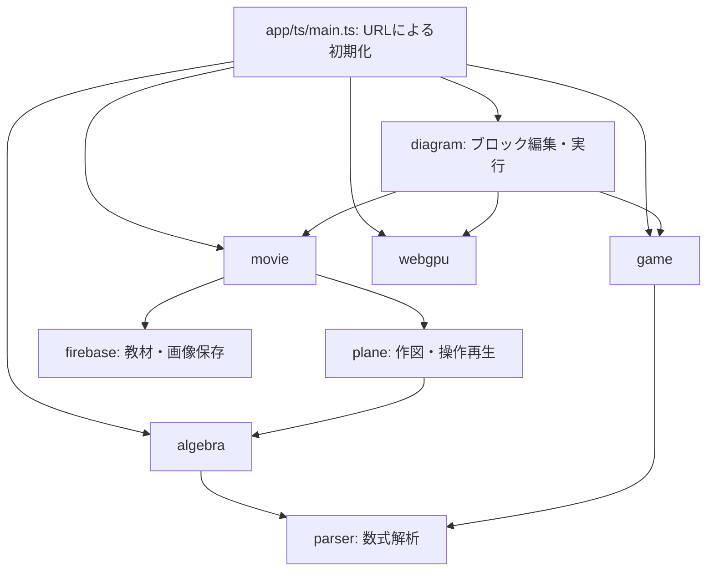

# uroaの構成と機能

調査日: 2026-10-09（日本時間）。主要ソース、設定、既存文書を読んだ静的な調査結果。全行の監査や実行検証ではなく、未コミット変更を含むローカル状態を対象とする。2026-10-09の調査では、アプリ起動、ビルド、テスト、外部API呼び出し、Firebase操作、実機操作は行っていない。後日の実行確認は [current-state.md](current-state.md) に条件と結果を記録する。

## 目的と全体構成

uroaは数学・科学教材を作成／再生するWebアプリ群。TypeScriptを中心に、KaTeXによる数式表示、Canvasによる図形・ゲーム描画、ブラウザー音声合成、Firebaseによる保存、WebGPUによる計算・描画を組み合わせる。

2026-10-11に旧13サブモジュールをすべて通常フォルダーへ移行し、旧履歴もuroaへ統合した（[移行記録](monorepo-migration.md)）。`.gitmodules`は廃止した。[package.json](../package.json)のnpm workspaces登録は従来どおり9個。P3で共通入口用の `app` を追加し、[tsconfig.sys.json](../tsconfig.sys.json)は計14個のTypeScriptプロジェクトを参照する。

実装の中心は各モジュールの `ts/`。ルートの `public/` には各画面のHTML、翻訳辞書、教材・ゲーム・ブロック図のデータがある。WebGPU実行資産は `webgpu/public/` にあり、ルートVite設定でコピーされる。

## アプリの入口と連携

[index.html](../index.html)と5アプリのソースHTMLは `app/ts/main.ts` を読み込む。[main.ts](../app/ts/main.ts)がDOMの準備後にURLパスで初期化先を選ぶ。公開ビルドでは従来どおり生成済みJavaScript/CSSをHTMLへ組み込む。

| パスの先頭 | 初期化 |
|---|---|
| `/algebra` | `initAlgebra()` |
| `/webgpu` | `initWebGPU()` |
| `/game` | `initGame()` |
| `/diagram` | `initDiagram()`の後、game・webgpu・movieも初期化 |
| `/movie` | `initMovie()` |
| その他 | `no project`を出力。ルート画面は各アプリへの入口 |

この入口は5アプリを初期化する。共通ライブラリーは各アプリが利用し、lessonなどには個別の入口がある。

`diagram/ts/procedure.ts`の `PlayGameBlock` は `playGameWorld()`、`PlayMovieBlock` は `playAllGraph()`、`PlayWebGPUBlock` は `playWebGPUPackage()`を呼ぶ。`diagram_util.ts`の `switchActiveModule()`が画面レイヤーを切り替える。

P3で [AppLifecycle](../app/ts/lifecycle.ts) を導入した。同じdocumentでは初期化Promiseを共有し、失敗・中断・破棄の状態を管理する。ブロック実行状態は [diagram/runtime.ts](../diagram/ts/runtime.ts) に分離し、子アプリの停止処理を共通入口で接続する。停止と破棄の違い、資源の所有、再読み込みが必要な範囲は [app-lifecycle.md](app-lifecycle.md) を参照する。



図は主要な呼び出し・依存関係の抜粋。i18nなどの共通依存や全インポートは省略する。

## モジュール一覧

| フォルダー | 機能 | 主要ソース |
|---|---|---|
| `app` | URLによる起動先選択、初期化・停止・破棄の管理 | [main.ts](../app/ts/main.ts)、[lifecycle.ts](../app/ts/lifecycle.ts) |
| `parser` | 数式の字句・構文解析、変数・有理数・演算・関数・束縛の木構造、LaTeX表示 | [parser.ts](../parser/ts/parser.ts)、[lex.ts](../parser/ts/lex.ts)、[tex.ts](../parser/ts/tex.ts) |
| `algebra` | 移項、代入、方程式の加算・除算、同類項整理、約分、定理照合、証明手順、数式の部分選択・書き換え | [algebra.ts](../algebra/ts/algebra.ts)、[simplifier.ts](../algebra/ts/simplifier.ts)、[formula_matcher.ts](../algebra/ts/formula_matcher.ts)、[ProofStep.ts](../algebra/ts/ProofStep.ts) |
| `plane` | 点・直線・円・楕円・円弧・多角形の作図、等長・等角・平行・垂直の制約、合同・相似などの関係管理、操作記録・再生 | [shape.ts](../plane/ts/shape.ts)、[tool.ts](../plane/ts/tool.ts)、[constraint.ts](../plane/ts/constraint.ts)、[deduction/](../plane/ts/deduction/) |
| `diagram` | ブロック接続による入力・計算・比較、条件分岐、繰り返し、待機、読み上げ、他アプリ実行、実機向けHTTP指令 | [index.ts](../diagram/ts/index.ts)、[block.ts](../diagram/ts/block.ts)、[procedure.ts](../diagram/ts/procedure.ts)、[port.ts](../diagram/ts/port.ts) |
| `game` | JSONによるCanvas教材構築、順次／並列動作、算数問題の生成・採点、筆算、効果音・正解演出、等角投影マップ | [index.ts](../game/ts/index.ts)、[registry.ts](../game/ts/registry.ts)、[lesson/exercise.ts](../game/ts/lesson/exercise.ts)、[action/sequencer.ts](../game/ts/action/sequencer.ts) |
| `movie` | 作図操作・数式・読み上げを組み合わせる教材アニメーション、連続再生、バックアップ | [index.ts](../movie/ts/index.ts)、[flow.ts](../movie/ts/flow.ts)、[timeline.ts](../movie/ts/timeline.ts) |
| `webgpu` | GPU計算と3D描画、データで定義する実行グラフ、物理シミュレーション、カメラ・パラメーター操作、画像保存 | [control.ts](../webgpu/ts/control.ts)、[main.ts](../webgpu/ts/main.ts)、[primitive.ts](../webgpu/ts/primitive.ts) |
| `firebase` | メール／パスワード認証、Firestoreの教材・フォルダー管理、教材間の関連図、画像・サムネイルのStorage保存 | [firebase.ts](../firebase/ts/firebase.ts)、[contents.ts](../firebase/ts/contents.ts)、[storage.ts](../firebase/ts/storage.ts)、[graph/](../firebase/ts/graph/) |
| `i18n` | 12言語の翻訳辞書、表示言語・音声言語、ブラウザー音声合成、読み上げ進行に応じた強調、ベクトル・UI共通処理 | [reading.ts](../i18n/ts/reading.ts)、[speech.ts](../i18n/ts/speech.ts)、[vector.ts](../i18n/ts/vector.ts)、[ui.ts](../i18n/ts/ui.ts) |
| `layout` | ボタン、入力、画像、ダイアログ、LaTeX表示などのHTML部品とGrid／Flex配置 | [main.ts](../layout/ts/main.ts)、[misc.ts](../layout/ts/misc.ts) |
| `lesson` | 独自教材テキストから見出し・本文・定義・定理・数式をHTMLへ変換 | [lesson.ts](../lesson/ts/lesson.ts) |
| `media` | マイク録音、録音の再生・ダウンロード | [media.ts](../media/ts/media.ts) |
| `plot` | README・設定ファイルはあるが、調査時点では実装ソースがない | [README.md](../plot/README.md)、[package.json](../plot/package.json) |

### 数学・図形処理の主要な境界

parserの `parseMath()` は `Term`、`App`、`RefVar`、`ConstNum`、`Rational`、`Binding`などの数式表現を作り、algebra、plane、game、lessonなどの基盤となる。

algebraでは [formula.ts](../algebra/ts/formula.ts)、[proof.ts](../algebra/ts/proof.ts)が定理・証明モデル、[math_file_parser.ts](../algebra/ts/math_file_parser.ts)が独自 `.math` ファイル、[manipulation.ts](../algebra/ts/manipulation.ts)が書き換え・簡約の操作を担当する。[tex.ts](../algebra/ts/tex.ts)は数式の部分選択と木構造・表示の対応を管理する。[galois.ts](../algebra/ts/galois.ts)には互除法や置換・群に関する実験コードがある。

planeでは [geometry_math.ts](../plane/ts/geometry_math.ts)が座標だけを使う垂線の足・直線からの距離・円への接点の計算、[geometry_order.ts](../plane/ts/geometry_order.ts)が点の並び順、[geometry.ts](../plane/ts/geometry.ts)が図形クラス、[matrix.ts](../plane/ts/matrix.ts)が行列計算を担当する。[factories.ts](../plane/ts/factories.ts)がツール・命題などの生成と初期化、[operation_storage.ts](../plane/ts/operation_storage.ts)が操作記録の保存、[operation_loader.ts](../plane/ts/operation_loader.ts)が操作記録の読込、[playback.ts](../plane/ts/playback.ts)が再生の実行、[playback_pointer.ts](../plane/ts/playback_pointer.ts)が再生時のポインター表示、[inference.ts](../plane/ts/inference.ts)が共有状態とサービス定義、[relations.ts](../plane/ts/relations.ts)が関係の登録・検索・初期化・再計算と関係ログの取り消し・再適用を担う。[all_functions.ts](../plane/ts/all_functions.ts)には互換用再exportと、今後分離する読み上げ・強調表示、画面イベントなどが残る。[operation.ts](../plane/ts/operation.ts)は操作記録、[json.ts](../plane/ts/json.ts)はWidget・MathEntity・TextBlockの基底機能と座標変換などを担当する。[plane_ui.ts](../plane/ts/plane_ui.ts)と [view.ts](../plane/ts/view.ts)は画面を担当する。

operation_storage.tsのsaveJson・getOperationsTextは、各OperationのtoJson()からversion 3の操作オブジェクト配列を保存する。plane_ui.tsは直接importし、公開入口はgetOperationsTextを直接再exportする。all_functions.tsにも2関数の互換用再exportを残す。Anchorは型のみのimportで、保存モジュールはGlobalStateを参照する。operation_loader.tsは7種類のOperationを生成し、termの生成は既存のAppServices.makeClickTermを使う。Operationは型のみのimport、実際に生成するクラスは実行時importとする。両モジュールからall_functions.tsや公開入口への直接importは追加しない。factories.tsにloadOperationsJSONの互換用再exportを残し、movieはplaneの公開APIを利用する。

旧図形JSON（図形のtypeName・参照・shapesから復元する形式）は廃止した。図形クラスのmakeObj・toObj、生成関数登録、parseObject・loadData、旧形式のファイルdropと専用状態は削除済み。操作記録から図形を生成する際のID管理・コンストラクター・関係登録は維持する。新しい図形に旧形式の変換処理を追加する必要はない。

保存・読込は操作オブジェクト形式に統一した。保存するJSONは `{version: 3, operations: [{op: "tool", name: "PointBuilder"}, ...]}`。loadOperationsJSONはoperationsがオブジェクト配列であることと、versionが指定されていれば3以上であることを確認する。公開教材all-kyozai.jsonの各docs要素はversionを持たないため、その入力も許容する。旧図形JSON・操作文字列配列・version 2.xは画面を消去する前に拒否する。loadOperationsText、version 2.0のconvertOperations、文字列形式への切替・一括変換用のisJson・newDocsは削除した。操作クラスのtoStringはログ用途で残る。ClickShape.toJsonの座標を小数2桁に丸める既存の処理は維持しており、任意精度の座標の完全一致は保証しない。

movieのreadDocは既定でローカルのall-kyozai.jsonから取得する。第3引数を `"firebase"` にするか、URLに `source=firebase` を指定すると、既存のFirebase取得経路を使う。どちらもloadOperationsJSONで読み込む。ローカル読込でもtheDocにID・名前・JSON本文を保持し、更新・バックアップへ渡す。バックアップ再生後も同じ情報を保持し、バックアップ完了はcommitBackUpをawaitして待つ。Firebaseのtextフィールドとバックアップには、このversion 3のJSONを文字列化して格納する。Firebase上の既存データの移行・削除は行っていない。diagramやFirebaseのフォルダー・関連図などの独自JSON保存は別形式として維持する。

2026-10-11に座標計算3関数を `all_functions.ts` から `geometry_math.ts` へ分離した。新しいモジュールは `Vec2` の型だけをimportし、実行時のimport、図形状態、登録処理、UIへの依存を持たない。`geometry.ts`、`shape.ts`、`tool.ts` の利用側は直接importする。既存の参照を維持するため `all_functions.ts` からも同じ関数を再exportする。`calcFootOfPerpendicular` は図形の位置・方向を取り出す処理、`calcLineLineIntersection` は `line.calc()` による図形の再計算を伴う処理のため、今回は同ファイルに残した。計算式・引数・戻り値と、従来の退化入力の扱いは変更していない。

続いて同日に関係管理の51関数を `relations.ts` へ分離した。平行・垂直と等しい円の内部コレクションも同じモジュールへ移し、`inference.ts` の共有コレクション・GlobalState・関係ログ・AppServicesの接続方法は維持した。図形・View・命題・数式の型は `import type` で参照し、実行時に `all_functions.ts`、`index.ts`、図形クラスをimportしない。利用側は機能別モジュールから直接importし、公開入口と `all_functions.ts` の既存exportも維持する。

2026-10-12に再生時のポインター表示5関数（initPlay、movePointerPix、movePointer、movePointerToElement、moveToolSelectionPointer）と3つの状態変数を [playback_pointer.ts](../plane/ts/playback_pointer.ts) へ移した。factories.ts・operation.ts・all_functions.ts内の利用側は直接importし、all_functions.tsには互換用再exportを残す。ToolSelectionは型のみのimportで、新しいモジュールからall_functions.ts・operation.ts・planeの公開入口への実行時importを追加しない。assert・rangeはi18nの同じ実装、linearはlayoutの既存の同じ実装を使い、layoutの公開入口にlinearのexportを追加した。ポインターの初期化、座標変換、20段階の移動、10ms・500msの待機指定、早送り時の処理を維持する。今回の分離はポインター表示に限り、PlayBackクラスとplayBack、読み上げ・図形の強調表示は後続作業とする。

続いて同日に、factories.tsのplayBack関数とoperation.tsのPlayBackクラスを [playback.ts](../plane/ts/playback.ts) にまとめた。関数・クラスの処理本体、操作順序、待機、再生前後の画面更新、GlobalState・AppServicesの接続は維持する。公開APIのplayBackは新モジュールから直接再exportし、factories.tsにも互換用再exportを残す。inference.tsのPlayBackは新モジュールからの型専用importへ変更する。operation.tsからPlayBackを再exportしないため、operation.tsとplayback.tsの直接の相互参照は作らない。ポインターの利用側もoperation.tsからplayback.tsへ移る。

playback.tsではinstanceofで使う操作クラスを実行時importし、Operation・MathEntity・Shape・Viewは型専用importとする。読み上げ・強調表示のplayShapeとプロパティ更新のsetPropertyは、処理本体を維持して再生実行だけを分離するため、既存のall_functions.tsからの参照を引き継ぐ。これらの依存と既存の間接的な循環は解消済みとは扱わず、後続の機能分離で整理する。

点の並び順判定2関数は `geometry_order.ts` に移した。後続のユーザー変更でplaneの `msg` はi18nのコンソール出力へ統一し、`logging.ts` は削除済み。登録・検索・取り消し・再適用の処理本体は変更していない。確認条件と結果は [current-state.md](current-state.md) に記録する。

これらに証明や幾何の関係管理コードはあるが、任意の定理・問題を自動的に解く完全な証明器という保証は今回確認していない。

### diagramの実機向け処理

ブロック追加のための現行実装・登録手順・実行方式・保存形式・既知の制約は [diagram実装ガイド](diagram-implementation.md) を参照する。構造体の未実装の式評価・型推論は [設計案](diagram-struct-design.md) と区別する。

[canvas.ts](../diagram/ts/canvas.ts)と [ui.ts](../diagram/ts/ui.ts)が編集・描画、[port.ts](../diagram/ts/port.ts)が接続・値の伝播、[json-util.ts](../diagram/ts/json-util.ts)がJSON保存を担当する。入力・計算ブロックと手続きブロックを接続し、Start／Stopで実行する。

2026-10-13に [ai-chat.ts](../diagram/ts/ai-chat.ts) のAIChatBlockを追加した。FunctionBlockで、文字列入力・出力を1つずつ持つ。InputTextBlock → AIChatBlock → TTSBlockへデータポートを配線し、Startで質問を送る。FunctionBlockのrunOnStartは既定falseで、AIChatBlockと同日追加のSpeechRecognitionBlockがtrue。[runtime.ts](../diagram/ts/runtime.ts)はStart時に入力欄の値を反映した後、対象FunctionBlockの前回出力を消し、データ依存順に1回ずつawaitする。全対象関数が成功してからActionBlockのチェーンを実行する。入力編集・コピー・JSON復元では送信しない。AIによるサーボ操作は実装しない。

[speech-recognition.ts](../diagram/ts/speech-recognition.ts)のSpeechRecognitionBlockはFunctionBlockで、入力なし、TextPort出力1つを持つ。[speech-client.ts](../diagram/ts/speech-client.ts)がSpeechRecognition／webkitSpeechRecognitionの機能検出・型定義・イベント待機を担当する。Startでlang=ja-JP、continuous=false、interimResults=falseの単発認識を開始する。確定結果を保持し、endで認識セッションの終了を確認してから出力・完了するため、SpeechRecognitionBlock → AIChatBlock → TTSBlockの順で待てる。結果は読み取り専用textareaに表示する。「認識終了」はstopでそこまでの結果を待ち、全体Stop・削除・Clear・読込・pagehide・破棄はabortとPromiseの即時終了で中断する。世代番号で遅延イベントを抑止する。30秒のタイムアウト・未対応API・権限拒否・無音・空結果・通信失敗では出力をundefinedにして後続へ進まない。JSON・コピーは言語設定だけを引き継ぎ、認識結果・認識オブジェクト・実行状態を含めない。復元や描画では認識しない。認識はブラウザーのサービスに依存し、オフライン・端末内処理を保証しない。[Web Speech API仕様](https://webaudio.github.io/web-speech-api/)。サンプルは [speech-ai-chat.json](../public/diagram/data/speech-ai-chat.json)。配置した全runOnStartブロックが対象なので、最初のデモは音声認識1個で構成する。

同日の後続指示により、学習者が自分のAPIキーを入力する教材向けの直接通信へ変更した。AIChatBlock内の「接続」でキー・モデル名のダイアログを開き、入力確定後にGoogleのmodels.getでモデル情報を取得する。「接続確認済み」はモデル情報の取得成功であり、質問生成の利用枠まで保証しない。Startでは [ai-client.ts](../diagram/ts/ai-client.ts)から `https://generativelanguage.googleapis.com/v1beta/interactions` へ直接POSTする。質問はinput、モデル名はmodel、store=falseを指定し、認証はx-goog-api-keyヘッダーへ渡す。APIサーバー・ViteのAPIプロキシ・Google SDK依存は不要。[公式REST仕様](https://ai.google.dev/api/interactions-api)、[モデル情報取得](https://ai.google.dev/api/models)

キーは各AIChatBlockのECMAScript privateフィールド #apiKeyだけに保持する。ダイアログのpassword入力を確定・キャンセル・閉じる際に消去する。Startごとの再入力は不要で、「切断」、そのブロックの削除、Clear、図読込、pagehide、破棄で保持を解除する。通常のStopでは保持済みキーを維持し、接続確認・回答待ちのみを中断する。キーをポート・JSON・コピー・localStorage・sessionStorage・URL・ログへ含めず、失敗時にGoogleの生のエラー本文を表示しない。fetchはcredentials=omit、redirect=errorとし、固定のGoogleホストへだけ認証ヘッダーを送る。ブラウザー内の実行権限や開発者ツールからの完全な隠蔽・メモリの物理消去を保証するものではない。モデル名は公開設定としてJSONへ保存し、初期値は旧バックエンドの既定値gemini-3.5-flash-liteに合わせる。別のGEMINI_MODELを使っていた場合はダイアログで同じモデル名を指定する。robot/chatと既存.envは変更しない。

送信中・成功・中断はcanvas、回答全文・エラーはスクロール可能な読み取り専用textareaで表示する。返答をHTMLとして実行しない。文字列ポートのプレビューはブロック内の幅に合わせて省略し、値本体とTTSへ渡す全文は維持する。空入力・未接続・通信失敗・不正／空回答・35秒のクライアントタイムアウトでは出力をundefinedにしてStartを失敗させ、TTSへ進まない。バックエンドの生のエラー本文は表示・ログへ転記しない。

Stop・Clear・図のJSON読込・実行中のブロック削除・pagehide・破棄で実行を停止する。待機は実行単位のAbortSignalとブロックのAbortControllerに接続し、通信がabortを無視しても待機を直ちに終了する。接続確認は10秒、回答待ちは35秒でタイムアウトする。削除・再実行の世代を確認し、遅延した回答を表示・出力・読み上げへ反映しない。Clearは全手続きも停止する。AIブロックは登録済みfactoryからコピー・JSON復元でき、保存は位置・型・ポート配線・モデル名で、キー・回答・通信状態・会話履歴を含めない。質問文は既存InputTextBlockのtextとして保存する。デモ図は [ai-chat.json](../public/diagram/data/ai-chat.json)。

以前追加したViteの `/api/ask` プロキシは解除し、既存開発用 `/api/save` を維持する。静的配信のみで直接通信する構成となり、ローカルのExpress起動は不要。Android・HTTPSへの実際のデプロイは今回未確認。

サーボは以下のBLE経路を使う。旧カメラ、顔検出結果、超音波距離センサー向けの処理は、ブラウザー内で取得を完結する構成ではない。[diagram_util.ts](../diagram/ts/diagram_util.ts)の `sendData()` は同一オリジンの `POST /send_data` にJSONを送る。

- 状態取得: `{command: "status"}`。応答キューから画像ファイル名、顔領域、距離を取り込む想定。
- 現在は `diy_sbc = false` によりキュー初期化・旧センサーの定期取得が無効。

2026-10-12に [ble.ts](../diagram/ts/ble.ts) を追加した。BLEConnectionBlockはFunctionBlockで、ツールボックスから配置し、canvasの接続ボタンからブラウザー標準のBLE機器選択を開く。周囲のBLE機器を候補にし、robot/esp32-ble-labと同じサービス・3つのcharacteristicを確認してINFOのACKを受信した後に接続済みとする。接続だけではサーボ有効化・IMU計測開始を送信しない。

同ファイルのBLEConnectionとdiagramBLEが1台の接続を管理する。複数の接続ブロックは状態を共有する。選択取消・非対応機器・切断・ACKタイムアウトを表示し、1.5秒周期のPINGとGATT書込／ACK待ちの直列化を行う。接続状態を購読する最後のブロック（BLEConnectionBlock、IMUBlock、ServoMotorBlock）の削除、Clear、別の図の読込、タブ非表示、pagehide、diagram破棄で切断する。取り消した接続試行の遅延完了は現在の接続へ反映しない。再接続はボタン操作で行い、保存・コピー・復元は接続状態を引き継がない。

2026-10-13にServoMotorBlockを [servo.ts](../diagram/ts/servo.ts) へ移し、既存のFunctionBlock登録方式で生成・コピー・JSON復元するようにした。数値入力は角度（度）。CH0～15と移動時間0～10000ms（初期1000ms）を設定し、「90°で有効化」がARM=9000を送る。有効化後の入力変更または「入力角度へ移動」でMOVEを送り、60～120°を0.01°単位へ丸めて送信する。接続・配置・JSON復元だけではARM/MOVEを送らず、再接続後も明示的な有効化が必要。

「このCHを停止」はDISABLE、「全サーボ停止」とdiagramの手続きStop・アプリ停止はSTOPを送る。STOPはIMU通知とBLE接続を保持する。チャンネル変更・ブロック削除では以前のCHをDISABLEする。停止・切断・CH変更・削除後に待機中のARM/MOVEを送らないよう、接続世代、CHごとの操作世代、ブロックの操作世代を確認する。連続する角度変更は未送信の古いMOVEを取り消す。停止ACKを確認できなければ切断する。全OFFのStatusやPCA異常で有効状態を解除し、サーボの自動再有効化は行わない。

有効状態は共有BLE接続のCH単位で保持するため、同じCHを指定した複数ブロックは同じ出力を操作する。CH・移動時間はJSONに保存し、接続・有効状態は保存しない。旧JSONのchannelと数値入力ポートは維持し、duration省略時は1000msとする。角度は内部指令値であり、MOVEのACKは受付結果で、動作完了や実角度の確認ではない。詳しいファームウェア処理は [esp32-ble-lab-firmware.md](esp32-ble-lab-firmware.md) を参照する。

InputNumberBlockはJSON読込時に数値欄を出力ポートへ反映する。ServoMotorBlockは配線接続時にその値を入力ポートへ取り込み、解除時は未入力に戻す。値の復元・配線だけではMOVEを送らず、有効化後の入力変更または移動ボタンで送信する。サーボの入力変更は`Servo input`、実際の送信は`BLE servo send`、ACK受信は`BLE servo ACK`としてコンソールにも表示する。送信・受信ログにはARM/MOVE/STOP/DISABLE、指令番号、CH、value、durationを含む。MOVEのvalueは角度の100倍であり、ACKは受付確認を示す。

続いて同日に [data_type.ts](../diagram/ts/data_type.ts) へ既存のVariable・Field・Struct・DataTypeを移し、vec3とIMU（gyro: vec3、acc: vec3）を登録した。PortTypeの接続方向とは別にPort.dataTypeを追加した。StructPortは入出力双方で構造体を検証・複製・深いfreezeを行い、1つの値として伝播する。NumberPort・TextPortは値の型を指定し、既知の型同士の不一致を接続時に拒否する。型未指定の既存Portは互換のため維持する。型参照は既存のポートJSONへ任意のdataTypeとして保存・復元し、ライブの計測値は保存しない。CalcBlock・CompareBlockは現段階では数値型で、構造体のフィールド計算は未実装。

[imu.ts](../diagram/ts/imu.ts)のIMUBlockはUltrasonicDistanceSensorBlockと同じく、受信値をポートへ設定するFunctionBlock。配置済みIMUBlockと接続済みBLEのIMU正常フラグを条件にSTREAM=10を送信する。複数ブロックの受信を共有し、最後のIMUBlock削除ではSTREAM=0を送る。BLE接続のみでは計測を開始しない。接続の所有者にIMUBlockも加わるため、BLEConnectionBlockを削除してもIMUBlockが残れば接続を保持する。Clear・非表示・pagehide・破棄では従来どおり切断する。

BLEの20バイトTelemetryをlittle endianで解析し、加速度をraw/16384×9.80665 m/s²、角速度をraw/131 °/sへ変換する。1通知を完成したIMU構造体として1回出力し、console.log("IMU", value)へ表示する。sequenceとESP32 uptimeはIMUSampleの付加情報とし、IMUのgyro・accへ混ぜない。未受信・切断・IMU異常・計測停止では出力をundefinedへ戻し、旧値を正常値として保持しない。温度・姿勢推定は未実装。

Port.getDataType()は明示されたdataTypeを優先し、型未指定なら単一の接続元をたどる。型が不明、接続元が複数、循環参照ならundefinedを返す。参照結果をdataTypeへ保存しないので、解除後に古い型を残さず、JSONには明示型だけを保存する。値の検証・描画・接続検査も有効な型を使う。subscribeConnections(listener)は配線更新後、両端へ{port, peer, connected}を同期通知し、返された関数で購読を解除する。重複接続・未接続の解除は通知しない。disconnectはどちらの端子からでも呼べ、disconnectAllとBlock.clearBlockで全配線を解除する。通知は当該ポートの接続変更に対するもので、ブロックをまたぐ式の型推論・型変更通知は未実装。

[plot.ts](../diagram/ts/plot.ts)のPlotBlockは1つの型未指定入力Portを持ち、接続元のStruct.membersを読み取って数値Fieldをグラフ化する。IMUValue・imuStructへの依存はなく、number、直接の数値Fieldを持つStruct、入れ子のStructを扱う。各構造体の直接の数値Fieldを1つのパネルにし、入れ子はパス名をタイトルとして横に並べる。IMUならgyro・accの2パネル、x/y/zはred/green/blueとなる。文字列Fieldは描画しない。Fieldへの単位情報はまだ追加しない。

[plot_data.ts](../diagram/ts/plot_data.ts)はFieldの列挙と履歴・統計を担当する。ブラウザー受信時刻を別途保持し、直近30秒、最大6000サンプルを保存する。データ受信時に線を更新し、初回取得と以後1秒ごとに系列ごとの平均・母標準偏差を計算する。各パネルは全系列のμ±3σの下限・上限をまとめ、1/2/5系の目盛りへ外側に丸める。σ=0では最小幅を設ける。3σ外の値は画面外になる場合がある。入力未取得・解除・配線変更で履歴を消し、受信待ちへ戻す。

グラフはcanvasの枠内へ位置を合わせたdivにPlotly.jsで描き、移動・画面リサイズへ追従する。見出し・ポート・枠は従来のcanvasで扱う。Plotly.reactは要求をまとめて直列実行し、削除時はタイマー・ResizeObserver・購読・描画予約を解除してpurgeとDOM削除を行う。ライブラリはdiagramのnpm依存plotly.js-gl3d-dist-min 4.1.2を初回配置時に遅延読込する。scatterと将来の3Dに必要な種類を含む配布版だが、今回のPlotBlockは2D時系列表示のみ。Viteの開発・公開ビルド双方でローカル資産として配信する。[公式配布構成](https://github.com/plotly/plotly.js/blob/main/dist/README.md)、[Plotly API](https://plotly.com/javascript/plotlyjs-function-reference/)

[ui.ts](../diagram/ts/ui.ts)のButtonをcanvasの再利用部品として拡張し、通常・押下・無効状態を描画する。[canvas.ts](../diagram/ts/canvas.ts)は前面のブロック内のポート・子ボタン・本体を判定する。ボタンを押した場合はブロックを動かさず、8 CSS pxを超える移動・pointercancelでは押下を取り消す。ブロック生成はblock.tsのregisterFunctionBlockへ登録し、新しいブロックモジュールをblock.tsから逆importしない。旧HTTPセンサーの定期取得はBLEへ接続していない。

### game・movieのデータと実行

gameのデータは `public/game/data/` にある。`initGame()`が開発／本番設定を読み、初期画面の等角投影マップを構築する。`loadWorld()`が指定ステージを読んでUIを作り、`playGameWorld()`がシーケンサーを起動する。

[widget/](../game/ts/widget/)にCanvas、文字、画像、入力、Grid、スクロール、メニュー、ツリーなどがあり、[math/](../game/ts/math/)に桁・画像による数の表示、筆算、方程式・証明UIがある。[lesson/sound.ts](../game/ts/lesson/sound.ts)と [lesson/confetti.ts](../game/ts/lesson/confetti.ts)は効果音・演出、[isometric/isometric.ts](../game/ts/isometric/isometric.ts)はマップ・ステージ選択を担当する。

movieはplaneの作図操作を音声・数式表示と組み合わせる。`flow.ts`は教材取得・連続再生・変換・バックアップ、`movie_ui.ts`は再生／編集画面と言語選択を担当する。保存にはfirebase、翻訳・読み上げにはi18n、HTML部品にはlayoutを使う。movie内のスライド・クイズ機能は未使用のためユーザーが削除した。独立モジュールの `lesson/ts/` は別機能として残る。

Firebase接続設定はソースにあるが、本番のデータ・権限・アクセスルールは今回確認していない。ローカルのルール見本を本番で有効なルールとは扱わない。

## WebGPUの構成

### 実行資産とエンジン

シミュレーション実行資産は同名の3ファイルを基本とする。

| ファイル | 役割 |
|---|---|
| `<id>.json` | metadata、GPU資源、Compute／Renderノード、バインディング、UIの定義 |
| `<id>.wgsl` | GPUの計算・描画コード。`// @shader:`で複数シェーダーを分割 |
| `<id>.js` | ノード呼び出し、繰り返し、`swapPingPong()`、`yield`を記述する独自DSL |

DSLはJavaScript風の構文だが、通常のJavaScriptファイルとして実行しない。`GraphManager.parseSchemaScript()`が独自の字句・構文解析を行い、ジェネレーターで実行順序を制御する。`.js`という拡張子だけを根拠に、任意のJavaScriptをブラウザーで実行する方式へ変更しない。

| ソース | 役割 |
|---|---|
| [index.ts](../webgpu/ts/index.ts) | URLのschema選択、従来デモ・パッケージ起動 |
| [main.ts](../webgpu/ts/main.ts) | デバイス・Canvas・カメラ・メッシュ準備、毎フレーム更新、画像保存 |
| [control.ts](../webgpu/ts/control.ts) | GPU資源・パイプライン・バインディング、Uniform転送、実行グラフ、読み戻し |
| [schema_validator.ts](../webgpu/ts/schema_validator.ts) | JSON定義と参照の検証・問題表示 |
| [sim_ui.ts](../webgpu/ts/sim_ui.ts) | 定義からスライダー・選択欄・ボタンを生成 |
| [primitive.ts](../webgpu/ts/primitive.ts)、[camera.ts](../webgpu/ts/camera.ts) | メッシュ、描画パイプライン、カメラ操作 |
| [lex.ts](../webgpu/ts/lex.ts)、[parser.ts](../webgpu/ts/parser.ts)、[syntax.ts](../webgpu/ts/syntax.ts) | 独自言語・シェーダー関連の解析と構文表現 |
| [builder/](../webgpu/ts/builder/) | TypeScriptの定義作成API、DSL構築、シリアライズ |
| [build/cli.ts](../webgpu/build/cli.ts) | 定義ソースからJSON・DSLを生成、既存資産との比較 |

CLIが生成するのはJSONとDSLであり、WGSLの計算コードは別ソースとして管理される。

### 14種類の物理エンジン

一覧は [schema_public_path.ts](../webgpu/ts/schema_public_path.ts)、作成用ソースは [build/sims/](../webgpu/build/sims/)、実行資産は [public/engines/physics/](../webgpu/public/engines/physics/) にある。

| ID | 主な対象 |
|---|---|
| `ball` | 球の運動 |
| `collision` | 球同士の衝突 |
| `surface` | 時間変化する曲面・法線・描画 |
| `vector_field` | 矢印によるベクトル場表示 |
| `life` | Conwayのライフゲーム |
| `ising` | 2次元Isingモデル |
| `md` | Lennard-Jones分子動力学 |
| `bec` | 2次元Gross–Pitaevskii方程式による平均場BEC |
| `hydrogen_orbital` | 水素原子軌道のボリューム描画 |
| `cfd_simple` | 簡易流体・染料移流 |
| `thermal_fem` | 規則格子上の熱拡散 |
| `em_fem` | 静電場のPoisson方程式を用いる計算・表示 |
| `fem_cg` | 共役勾配法による変形計算 |
| `fem_cg2` | 共役勾配法による弾性計算 |

`?schema=<id>`で起動する経路と、`?schema=all`で順にデモを行う経路がある。これら以外にも `package/test.json`、`ts/lgt/`などを使い、電磁波、電子雲、Hopfファイバー束、Liouville、ハミルトンベクトル場、三体問題、U(1)／SU(2)／SU(3)格子ゲージ、Higgs、HMC、フェルミオン、CG・Dirac CGなどのデモを起動する。

名称は実装対象を示し、数値モデルの物理的妥当性を今回検証したものではない。BECのtemperatureはコメント上、相互作用を調整する教材用パラメーターで、実際の有限温度モデルとは区別される。

## ビルドと配信

| ファイル | 役割 |
|---|---|
| [tsconfig.sys.json](../tsconfig.sys.json)、[tsc-all.bat](../tsc-all.bat) | TypeScript一括ビルド。バッチはルートのnpmコマンドを呼ぶ |
| [vite.config.ts](../vite.config.ts) | 共通入口、モジュール別名、WebGPU資産コピー、5アプリの公開用HTML生成 |
| [vite.config.base.ts](../vite.config.base.ts) | 現在は参照されていない共通設定の補助ファイル |
| [build_all.py](../build_all.py) | ルートの `npm run build` を呼び、終了コードを返す互換用入口 |
| [scripts/check-dist.mjs](../scripts/check-dist.mjs) | 5アプリの公開HTML・参照資産・WebGPUコピー資産の静的確認 |
| [tests/test.py](../tests/test.py) | 既存5アプリ回帰テスト。接続先URLを引数または環境変数で指定 |
| [web.py](../web.py) | Flaskでdistを配信。ポート5000 |
| [firebase.json](../firebase.json) | Firebase Hostingの公開先をdistに設定 |
| [movie/python/make_audio.py](../movie/python/make_audio.py) | Azure Speechによる教材音声生成 |
| [movie/python/timeline.py](../movie/python/timeline.py) | 音声長集計、音声結合、字幕生成などの補助処理 |

Vite開発サーバーの `POST /api/save` は数式関連のテキスト／JSONを `public/algebra/output/` に保存する。この開発用ミドルウェアが、静的HostingやFlask配信にも存在するとは扱わない。

ルートの `npm run install:all` は `npm install` を実行し、共通依存と登録済み9 workspacesを準備する。lesson、media、movie、plotと共通入口appは独自のnpm依存を宣言していない。`npm run build:all` は `tsc -b tsconfig.sys.json` で14プロジェクトを処理する。各プロジェクトの旧buildスクリプトも `tsc -b` だけだったため、サブモジュール単位の重複実行を外した。

2026-10-11に `build`、`verify`、開発・preview・回帰テストのnpmコマンドを追加した。`verify` はTypeScript・公開ビルド・成果物の静的確認を行い、Playwrightは `test:e2e` で明示的に実行する。Python一括ビルドの旧同期処理は廃止した。準備手順と今回の検証範囲は [build-and-test.md](build-and-test.md) を参照する。

移行時の検証は [移行記録](monorepo-migration.md)、ユーザーによる新規インストール・依存更新後のPlaywright成功は [dependency-update.md](dependency-update.md) に記録する。Flask配信は今回未確認。

```powershell
# 作業ディレクトリ: uroa
npm.cmd run dev
npm.cmd run verify
npm.cmd run preview
# 既存Python入口もルートのnpmビルドを呼ぶ
python build_all.py
python web.py
```

WebGPU定義CLIは出力・比較先を現在のディレクトリ基準で解決する。次の例は **uroa/webgpu** で実行し、tsxが利用できる環境を前提とする。

```powershell
# 作業ディレクトリ: uroa/webgpu
npx tsx build/cli.ts build/sims/ball.ts --check
npx tsx build/cli.ts build/sims/fem_cg.ts --check
```

`--check`はJSON内容比較とDSL文字列／トークン比較を行う。比較先が存在しない場合はスキップするため、成功終了だけで資産の存在やGPU動作を保証しない。

## 未実装・無効化・調査上の制限

| 対象 | 確認した状態 |
|---|---|
| diagramのセンサー取得 | `diy_sbc = false`によりキュー初期化・定期取得は無効。サーボ送信は別に残る。 |
| `POST /send_data` | 呼び出し側はあるが、調査した現行ソースに対応サーバー実装が見つからない。web.pyは静的配信、Viteには別の `/api/save` がある。 |
| mediaのCanvas録画・音声合成 | コメントブロック内で実行されない。 |
| lessonの `@let` | `readLet()`が例外を投げる未実装。 |
| plot | 機能を実装したソースがない。 |
| 実行検証 | 今回は未実施。ソースにあることと動作確認済みであることを区別する。 |

`webgpu/framework.md`や `NEXT_TASKS.md`は参考資料だが、未完了リストが現行実装と一致するとは限らない。実際にはbuild/simsに14種類の定義がある。再開時は現行ソースを確認する。

`tmp/zip/`にはサブプロジェクトの過去の展開コピーがある。`tmp/hmc.py`はNumPyによる回帰モデルのHMC実験、`tmp/icon.py`はPNGからICOを生成する補助スクリプトで、統合アプリの入口から呼ぶ構成ではない。

## robotとの関係とフィジカルAI教材

隣接する [robotの設計文書](../../robot/docs/architecture.md) に、AI質問画面、BLEサーボ・IMU操作、DCモーター復旧確認を記録している。

| 機能 | 現在の方式 |
|---|---|
| uroa/diagramの旧カメラ・センサー処理 | HTTP `POST /send_data` |
| uroa/diagramのBLEConnectionBlock・ServoMotorBlock・IMUBlock・PlotBlock | Web BluetoothでrobotのESP32へ接続・切断し、サーボをARM/MOVE/DISABLE/STOPで制御。IMUを構造体ポートとconsoleへ出力し、汎用PlotBlockへ配線してgyro・accを表示 |
| robot/esp32-ble-lab | Web Bluetoothと独自バイナリプロトコル |
| robot/chat | HTTP `POST /api/ask`経由のGemini応答 |
| uroa/diagramのAIChatBlock | 学習者のキーをブロック内で一時保持し、ブラウザーからGoogle Interactions APIへ直接質問。回答全文をTTSBlockへ渡す |

BLE接続・サーボ・IMUはrobotのESP32と同じGATT仕様を使う。AIChatBlockは教材向けのGoogle直接通信で、robot/chatのバックエンドとは独立している。AI回答とサーボ操作も独立しており、実装・模擬確認・実機確認はそれぞれ区別する。

2026-10-12にユーザーがデモ仕様を提示した。diagram内でInputTextBlock・チャットブロック・TTSBlockを使うAIチャットと、ServoMotorBlock・IMUBlock・グラフブロックを使う実機操作／計測の2種類を独立して作る。AIによる定型動作の選択・サーボ操作は要件ではない。ESP32、PCA9685、SG90、MPU-6050／GY-521を使い、IMU取得はユーザー確認済み。本番は携帯電話のアクセスポイント経由でインターネットへ接続した本人のAndroidタブレット、予備はWindowsのローカルVite。HTTPS・公開AIバックエンドの配置とサーボ動作はエージェント未確認。

## 更新方法

役割、依存関係、入口、通信・データ形式、実装範囲が変わったら該当節を更新する。実行検証を追加する際は日付・対象・条件・結果を記録し、今回の静的調査や既存文書と区別する。詳細な設計判断は専用記録へ分け、AGENTS.mdは短く保つ。

## 議論で共有された経緯と改善案

2026-10-10追記。ユーザーによると、planeのall_functions.tsはnamespaceからモジュールへの移行時に循環参照を回避するため作られた。分割を検討するときは、既存のimport type、AppServices、生成関数登録による依存の整理を維持する。

ユーザーはrobotの全機能をuroaへ組み込む方針を示した。単一リポジトリ化、5アプリの回帰テスト、共通入口と責任分担の整理を含む作業案と実施結果は [improvement-plan.md](improvement-plan.md) に記録する。単一リポジトリ化は完了済み。robotの取り込み・実機連携は未実施。

## 2026-10-10: 機能索引と実行確認

[features.md](features.md)に59項目の目的・入口・関連ソース・資産・実装範囲を整理した。[current-state.md](current-state.md)にGit状態、入力資産の識別、型確認、Viteビルド、5画面の起動・代表操作、未確認項目を記録した。

開発環境の5画面表示と一部操作を確認した一方、型確認には7件の診断がある。ルートViteビルドは成功するが、previewではalgebraの保存API要求が404、残る4画面のTS入口も404となった。旧diagramサンプルのTTSテキストが再保存で失われることも確認した。別経路のbuild_all.pyはPython環境の問題で未実行。全機能、外部サービス、Android、実機の確認済みを意味しない。

## 2026-10-10: 公開用入口・保存API依存・型診断の修正

buildAppPagesPluginがalgebra・game・diagram・movie・webgpuのHTMLへ共通入口の生成済みJavaScript/CSS参照を組み込む。ソースHTMLのTypeScript参照は維持し、WebGPUのindex.htmlはビルド時の静的コピーから除外して生成結果の上書きを防ぐ。開発時は従来通りコピー対象として配信する。

testProofはexample.mathの読込・解析を行い、開発用出力はsaveProofOutputへ分けた。initAlgebraはViteのDEV条件でのみ保存を実行し、保存失敗は警告にして後続の簡約を継続する。読込・解析の失敗はこのcatchの対象外。

KaTeX内部の未使用importを削除し、makeUIFromJSONへButton/Labelの型オーバーロードを追加した。クラス参照はimport typeとし、実行時の生成関数登録は維持した。全体の型確認、ルートViteビルド、開発・ビルド後の5画面起動、保存APIの成功・失敗・非呼出しを確認した。音声終了を模擬した完了確認と通常音声の確認は区別する。条件と残件は [current-state.md](current-state.md) の修正後の記録を参照する。
