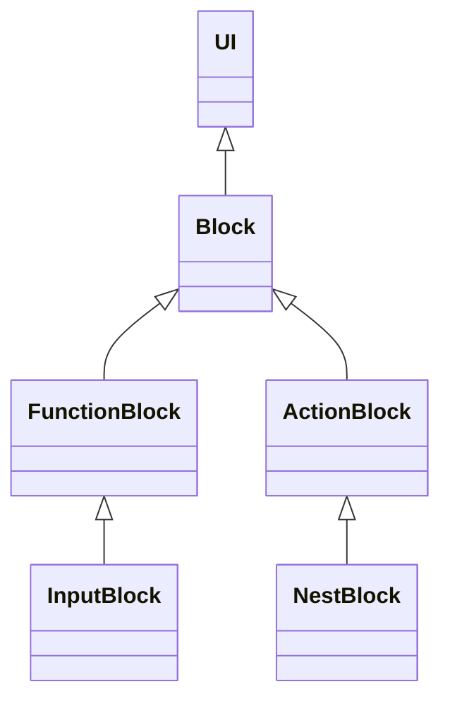

# diagramの機能とブロック実装ガイド

更新日: 2026-10-13（日本時間）。初版調査時のHEAD: `db3f4d2`。今後ブロックを追加するAI・開発者向けに、現行ソースの構造、呼び出し順、拡張箇所、制約をまとめる。初版はソースの静的調査で作成し、その後の音声認識追加を反映した。変更ごとの検証条件・結果は [build-and-test.md](build-and-test.md) を参照する。

## 1. 着手時に決めること

最初に [AGENTS.md](../AGENTS.md)、対象ソース、Git状態を確認し、既存の変更を保持する。実機やrobotの変更を伴う場合は [robot/AGENTS.md](../../robot/AGENTS.md) も読む。全体の優先順位は [improvement-plan.md](improvement-plan.md)、アプリ間の関係は [architecture.md](architecture.md)、構造体の後続設計は [diagram-struct-design.md](diagram-struct-design.md) にある。

新しいブロックについて、次の項目を先に決める。

- 入出力の型、入力未取得時の扱い、接続元を1つに限定するか。
- 値が変わるたびに動くか、Startで1回動くか、専用ボタンで動くか。
- 後続ブロックが完了を待つ必要があるか。
- 外部通信・機器・タイマー・DOMの所有者と、中断・削除時の解放方法。
- JSONへ保存する設定、コピーする設定、保存しないライブ状態。
- 必要なブラウザー操作・権限・実機条件と、最小の動作確認シナリオ。

「FunctionBlockを継承すればStartで実行される」「配線すれば入力値が自動転送される」という前提では実装しない。どちらも追加の処理が必要な場合がある。

## 2. ソースの役割

主な編集対象は `diagram/ts/`。`diagram/lib/` とルート `dist/` は生成物で、`tmp/` のコピーは現行実装ではない。

| ファイル | 役割・最初に見る箇所 |
|---|---|
| [app/ts/main.ts](../app/ts/main.ts) | URLで起動先を選び、diagram → game → webgpu → movieを初期化。子アプリ停止を接続し、pagehide・HMRで片付ける |
| [index.ts](../diagram/ts/index.ts) | Main、initDiagram、Start/Stop、ツールの型番号・生成、JSON読込、disposeDiagram |
| [canvas.ts](../diagram/ts/canvas.ts) | Canvasのpointer操作・再描画、ToolItem、Editor、ActionBlockのルート抽出・配置 |
| [ui.ts](../diagram/ts/ui.ts) | UIの位置・余白・枠・描画コンテキスト、children、Label、canvas上のButton |
| [block.ts](../diagram/ts/block.ts) | Block、FunctionBlock、InputBlock、入力・旧センサー・数値計算、FunctionBlockのfactory登録 |
| [procedure.ts](../diagram/ts/procedure.ts) | ActionBlock、NestBlock、TTS・Sleep・If・InfiniteLoop・子アプリ実行、型名によるブロック生成 |
| [runtime.ts](../diagram/ts/runtime.ts) | 実行中・停止フラグ、Start時の依存順実行、Actionチェーン、取消可能な待機、停止購読 |
| [port.ts](../diagram/ts/port.ts) | 配線、値の伝播、接続変更通知、NumberPort・TextPort・StructPort |
| [data_type.ts](../diagram/ts/data_type.ts) | Struct・Field・DataType、値の検証・複製・freeze、vec3・IMUの登録。UI・BLE・parserへの依存なし |
| [json-util.ts](../diagram/ts/json-util.ts) | theEditorの保持、saveJsonでの採番・Download |
| [diagram_util.ts](../diagram/ts/diagram_util.ts) | PortType、共有canvas、UI要素、再描画回数、レイヤー切替、旧sendData |
| [ble.ts](../diagram/ts/ble.ts) | BLEConnectionBlockと共有diagramBLE、接続・ACK・指令・IMU通知 |
| [servo.ts](../diagram/ts/servo.ts) | 明示的な有効化、角度入力からのMOVE、CH・時間・停止操作 |
| [imu.ts](../diagram/ts/imu.ts) | IMUの受信購読と構造体出力 |
| [plot.ts](../diagram/ts/plot.ts)、[plot_data.ts](../diagram/ts/plot_data.ts) | 汎用時系列グラフのDOM・Plotly管理と、型からの系列列挙・履歴・統計 |
| [ai-chat.ts](../diagram/ts/ai-chat.ts)、[ai-client.ts](../diagram/ts/ai-client.ts) | 学習者のキー入力・一時保持、Google直接通信、応答解析・待機取消 |
| [speech-recognition.ts](../diagram/ts/speech-recognition.ts)、[speech-client.ts](../diagram/ts/speech-client.ts) | 単発の音声認識、認識セッション終了待ち、文字列出力、取消・遅延イベント抑止 |

入口HTMLは [public/diagram/index.html](../public/diagram/index.html)。保存図・サンプルは [public/diagram/data/](../public/diagram/data/) に置く。

## 3. 継承と実行方式



`Block`はports、配置・枠描画、makeObj、clearBlockを持つ。`copy()`と`setBoxSize()`は派生クラスが提供する。基底の`calc()`・`run()`は例外を投げ、`valueChanged()`はブロック名をログへ出すだけである。

| 方式 | 実装する場所 | 現行の参照例 |
|---|---|---|
| 入力欄から値を出す | InputBlock.updatePortとinputイベント | InputTextBlock、InputNumberBlock |
| 入力値の通知に反応する | async valueChanged | ServoMotorBlock、PlotBlock |
| 外部イベントから値を出す | 購読callback → outputPort.setPortValue | IMUBlock |
| Startで完了を待つ関数 | FunctionBlock.runOnStart=true、resetForRun、async run | AIChatBlock |
| 手続き順に完了を待つ処理 | ActionBlock.async run | TTSBlock、SleepBlock |
| 専用ボタンで操作する | childrenにButtonを返し、clickに処理を接続 | BLEConnectionBlock、ServoMotorBlock、AIChatBlock |

FunctionBlockは通常のデータブロックで、手続き用のtop/bottomポートを自動追加しない。ActionBlockはtopPort・bottomPortを持ち、nextBlockで次の手続きをたどる。両者の配線と待機方式を混同しない。

## 4. 現在のブロックと実装範囲

ツールボックスは現在23種類。以下はソースの実装説明で、実機で動いたという保証ではない。

| ブロック | 入出力・動作 | 主な制約 |
|---|---|---|
| InputTextBlock | 文字列出力。inputイベントとStartで入力欄を反映 | JSONはtext。読込時の即時出力反映はInputNumberBlockと同じ実装ではない |
| InputNumberBlock | NumberPort出力。非有限値はundefined | JSON読込時に値を反映する |
| InputRangeBlock | range、最小・最大の入力欄、出力 | 現在の出力は型未指定Port。DOMの所有・解除を確認する |
| CalcBlock／CompareBlock | 数値入力、数値の式評価。比較結果は0/1 | calcは明示的な呼出し。構造体の式評価・一般的な自動計算スケジューラーは未実装 |
| BLEConnectionBlock | 機器選択・接続・切断ボタン。共有接続状態の表示 | 接続だけではサーボを有効化しない |
| ServoMotorBlock | 角度のNumberPort入力。ARM、MOVE、DISABLE、STOP | 有効化は明示操作。角度60～120°、CH0～15、時間0～10000ms。値は実測角度ではない |
| IMUBlock | gyro・accのvec3を1つのStructPortから出力 | 配置したブロックで10Hz STREAMを共有。姿勢推定ではない。現行console.logはコメントアウトされている |
| PlotBlock | 型未指定入力からnumber・Structの数値Fieldをグラフ化 | 直近30秒、最大6000サンプル、1秒ごとの統計とμ±3σ。2Dのみ。Fieldの単位情報は未実装 |
| AIChatBlock | TextPort入力・出力。Startで1問の回答全文を待つ | Google直接通信。キーはブロック内で一時保持。会話履歴・ストリーミング・サーボ操作は実装しない |
| SpeechRecognitionBlock | 入力なし、TextPort出力。Startで単発の発話とセッション終了を待つ | ja-JPが既定。Web Speech API／webkit接頭辞を機能検出。30秒タイムアウト、権限・無音・空結果・通信失敗で後続を止める。実音声・Androidは別途確認 |
| TTSBlock／SleepBlock | 文字列の読み上げ／数値秒の取消可能な待機 | ActionBlock。runの入力は未取得値を許す読み取りではない |
| IfBlock／InfiniteLoop | 条件値1で内側を実行／内側を繰り返す | NestBlock。IfのconditionPortは型未指定Portで、isTrueは値1を判定する |
| PlayMovieBlock／PlayGameBlock／PlayWebGPUBlock | 子アプリを実行してdiagramへ戻る | game・webgpuはTextPortで対象を指定。共通入口の停止接続も確認する |
| CameraBlock／FaceDetectionBlock／UltrasonicDistanceSensorBlock | 旧画像・顔領域・距離の表示と出力 | 旧POST /send_data経路。diy_sbc=falseで定期取得は無効。実ブラウザーのカメラ認識を実装済みと扱わない |
| ConditionGate／TriggerGate | 条件・入出力ポートや枠を定義 | ConditionGateの値ルーティング、TriggerGateのrunは未実装。配置できることと実行できることは別 |

`JoyStickBlock`はblock.tsの生成関数にあるが、現在の23種類のツールには入っていない。旧`plot/`フォルダーと、実装済みの`diagram/ts/plot.ts`は別のものとして扱う。

## 5. 値・配線・型の契約

### 5.1 ポートの方向と値の型

`PortType`は接続の用途・方向で、`DataType`は渡す値の型である。

| 用途 | 接続する組合せ |
|---|---|
| データ | outputPort → inputPort |
| 手続き | bottom → top |

`condition`は現在この接続ペア一覧に含まれない。Ifの条件端子が見えることだけで、通常のデータ配線が可能と判断しない。

NumberPortは有限のnumber、TextPortはstring、StructPortは登録Structを検証する。型未指定Portは旧ブロック・汎用入力用に残る。`undefined`は未取得・解除・失敗を示す値として使える。numberValue・stringValue・structValueは未取得値を正常値として返すAPIではないので、画面の状態表示にはvalueを確認してから読む。

DataTypeはnumber、string、登録されたStructを扱う。boolean専用型、配列、再帰的Struct、フィールドの単位は未対応。Structの型は名前で登録し、Fieldが参照する型を先に登録する。同名の再登録は例外になる。`vec3`と`IMU`はdata_type.tsで既に登録済み。

Struct値はフィールドの過不足・各値の型を検証し、setPortValueで入出力双方に複製・深いfreezeを適用する。出力後に元の計測オブジェクトを変更して更新を伝える方式にしない。

### 5.2 配線と値の伝播

`connect()`は方向・型を検査し、sources／destinationsを更新して両端へ接続変更を通知する。**接続時に現在値を自動転送しない。** 新しい入力は必要に応じてsubscribeConnectionsから単一のsource.valueを取り込み、解除時はundefinedへ戻す。ServoMotorBlock・AIChatBlock・PlotBlockが参照例になる。

`setPortValue()`は自ポートを検証・更新し、接続先へ同期的に再帰伝播した後、接続先ブロックのvalueChangedを呼ぶ。そのPromiseを待たず、拒否はログへ出す。したがって、この通知で非同期通信を始めてもStartやTTSは完了を待たない。待機が必要な処理にはrunOnStartまたはActionBlockを使う。

通常の値更新はvalueへの直接代入を避けてsetPortValueを使う。配線もsources／destinationsを直接書き換えず、connect／disconnectで両端の状態と購読通知をそろえる。

`connect()`自体は接続元を1つに限定しない。`prevPort()`・`nextPort()`は対象がちょうど1つの場合だけ返す。`getDataType()`は明示型を優先し、型未指定なら単一接続元をたどる。結果をキャッシュせず、複数接続元・循環参照では未確定となる。新しいブロックは入力の個数と未確定型の扱いを明示する。

データ配線の循環を全経路で拒否する機構はない。setPortValueは再帰伝播するため、循環のある図を安全に評価できると扱わない。

### 5.3 calcとvalueChangedの違い

`propergateCalc()`は出力に接続された次のブロックのcalcを呼ぶ別経路である。綴りは現行APIどおり`propergateCalc`。基底calcは例外で、基底valueChangedはcalcを呼ばない。Startの依存走査も通常のFunctionBlockのcalcを自動実行しない。

新しい純粋計算ブロックは、valueChangedから同期計算を呼ぶなど呼出し経路を明示する。副作用をvalueChangedとcalcの両方へ重複実装しない。ServoMotorBlockはvalueChangedでMOVEし、calcを空にして重複送信を防いでいる。式パーサーがドット参照を解析できることと、CalcBlockが構造体を評価できることも別である。

## 6. Start・完了待ち・Stop

index.tsのstartProceduresは次の順序で動く。

```text
runProcedures（実行中の再起動を抑止、停止フラグとAbortControllerを更新）
  → 全InputBlock.updatePort
  → runStartFunctions
      → runOnStart=trueの全ブロックをresetForRun
      → データ接続元を深さ優先で走査
      → 対象FunctionBlock.runを依存順に1回ずつawait
  → getTopActions（topに接続元がないActionBlock）
  → ルート順にrunBlockChain（各runをawait）
  → finallyでStartボタンを戻す
```

現在runOnStart=trueなのはAIChatBlockとSpeechRecognitionBlock。対象の全ブロックを実行してから全Actionチェーンを開始する方式で、TTSごとに必要な関数だけを遅延実行する方式ではない。未接続の音声認識も対象になり、複数配置すれば順に発話を待つ。最初の音声AIデモは認識ブロック1個で構成する。単独のTTSBlockもルートとして実行される。runStartFunctionsは走査中の依存循環を検査するが、その前の出力リセットや通常の値伝播まで安全にするものではない。

Startで待つ新しいFunctionBlockでは、runOnStart=true、前回出力を消すresetForRun、完了を表すPromiseを返すrunを実装する。runは失敗時に出力をundefinedへ戻して例外を投げる。途中状態は画面へ表示し、完了した値だけを出力する。例外が上へ伝われば以後のActionチェーンへ進まず、Startボタンはfinallyで戻る。

`runtime.stopDiagram()`はstopFlag、実行のAbortController、停止購読、音声、子アプリへ停止を伝える。`index.stopDiagram()`はこれに加えて接続中BLEのサーボSTOPも要求する。UIの全体Stopはindex側を経由する。runtimeはprocedure・blockを型専用importし、indexへの実行時importを増やさない。

`getProcedureSignal()`はStart単位のSignal。Startの外でボタン操作を開始する際、以前のClearやStopで既にabortされたSignalを再利用しない。独立したAbortControllerを持ち、必要ならsubscribeDiagramStopで全体停止へ接続する。購読が返す解除関数を削除時に呼ぶ。

非同期処理には次の両方が必要である。

- AbortSignal・機器APIのabort等による実処理の中断と、待機Promiseの速やかな終了。
- removedフラグ・世代番号・Signalの再確認による、遅延完了の表示・出力・後続実行の抑止。

AIChatBlockとai-client.tsのwaitAIRequestは、通信がabortを無視する場合や本文解析待ちも含む参照例。受信イベントが終了通知を返さない機器・認識APIでは、Promiseの解決／拒否と後片付けを明示し、停止中のisRunningを残さない。

## 7. UI・配置・ツールボックス

枠・ポート・ボタンはcanvas、入力欄・回答欄・グラフ・ダイアログはDOMを併用する。新しいDOMは基本的にlayer-diagramへ付け、位置更新とclearBlockでの除去を組にする。

- setBoxSizeでサイズを決め、setBlockPortPositionで位置とポート位置をそろえる。
- setPositionのoverrideはsuperを呼び、DOM位置を追従させる。
- ボタンはchildrenで返し、setPosition／setPortPositionsで位置をそろえる。
- Editor.addBlockは描画コンテキストを設定するが、任意の設定復元やDOM配置まで行わない。
- UI.copyUIは位置・サイズ・ctxだけをコピーする。派生の設定、DOM位置、接続、ライブ状態は自動コピーされない。
- drawの変更後はrequestUpdateCanvasで再描画を予約する。ctx.save／restoreで描画状態を戻す。
- DOMとcanvasの座標・拡大率が異なる場合はPlotBlock.positionPlotを参照する。

ヒット判定は前面のブロックからポート → children内Button → 本体を調べる。親ブロックの範囲が先に判定されるので、Buttonを枠外へ配置して描画だけ見える状態にしない。ボタン操作は8 CSS px超の移動・pointercancel・lostpointercaptureで取り消し、ブロック削除後のclickを抑止する。

ツールボックスはブロック実体の配列ではなく、toolIdxを持つToolItemの配列である。現在はpointerup時にmakeBlock(toolIdx)で生成する。テストも`editor.tools`からブロッククラスを探すのでなく、toolIdxとgeBlockNameで探す。inToolboxの旧分岐は残るため、派生ブロックではプレビュー用インスタンスが外部通信・計測を始めないようにする。

### 現行ツールボックスの注意点

- Editorは型名でAIChatBlockを4番目、SpeechRecognitionBlockを5番目へ移す。新しい型番号の末尾追加でAIの表示順が変わらないようにしている。
- 各ToolItemは32×32で、長い型名の描画全体がヒット領域になるわけではない。縦配置も画面高に応じたスクロール・折返しを実装していない。項目追加時には小さい画面と文字のクリック位置を実際に確認する。
- 通常のToolItem生成はpointermoveの有無を使い、微小ドラッグの閾値や安全なドロップ領域を網羅していない。
- 新しいActionBlockをToolItemから生成する分岐と、既存ActionBlockを移動してtopへ自動接続する分岐は別である。近くへ配置すれば自動接続されると仮定しない。

これらは現行ソースの制約であり、この文書作成で修正した項目ではない。

## 8. ブロック追加の登録手順

### FunctionBlock

1. `diagram/ts/新モジュール.ts`にクラスを実装する。block.tsから新モジュールへ逆importしない。
2. モジュール末尾で`registerFunctionBlock(NewBlock.name, () => new NewBlock({}))`を呼ぶ。
3. index.tsからモジュールをimportし、登録コードが実際に評価されるようにする。
4. index.tsのBlockClassCount、makeBlock、geBlockNameを同じ型番号で更新する。
5. 前節のToolItem順序・表示範囲を確認する。
6. 保存する設定に応じてmakeObj、loadObj、copyを実装し、後片付けと検証を追加する。

factory登録は型名による生成・FunctionBlock.copy・JSON復元用で、ツールボックス登録とは別である。registerFunctionBlockは現在同名factoryを上書きするため、名前衝突を自動検出する登録機構と扱わない。

### ActionBlock

現在はprocedure.tsのmakeActionBlockByTypeNameのswitchへ追加する。run、setBoxSize、必要なデータポートを実装し、上記と同様にindex.tsの3箇所を更新する。外部ActionBlockの汎用factory登録APIは現時点ではない。新しい制御構造を作る場合はNestBlockのinnerPort・dependentPorts・位置計算も確認する。

### 小さい同期FunctionBlockの記述例

以下は拡張例で、現行アプリに登録された機能ではない。通信やDOMを持たず、文字列を大文字へ変換する例である。保存する独自設定がないため、基底のmakeObj・copyを使う。

```ts
import { Vec2 } from "@i18n";
import { FunctionBlock, registerFunctionBlock } from "./block";
import { PortType, theCanvas } from "./diagram_util";
import { TextPort } from "./port";
import type { Attr } from "./ui";

export class UpperTextBlock extends FunctionBlock {
    readonly inputPort = new TextPort(this, PortType.inputPort);
    readonly outputPort = new TextPort(this, PortType.outputPort);
    private removed = false;
    private releaseConnection: () => void;

    constructor(data: Attr) {
        super(data);
        this.ports = [this.inputPort, this.outputPort];
        this.setBoxSize();
        this.releaseConnection = this.inputPort.subscribeConnections(() => {
            this.inputPort.setPortValue(this.inputPort.prevPort()?.value);
            this.calc();
        });
    }

    setBoxSize(): void { this.boxSize = new Vec2(240, 80); }
    async valueChanged(): Promise<void> { this.calc(); }
    calc(): void {
        if (this.removed || this.inToolbox) return;
        const value = this.inputPort.sources.length === 1 ? this.inputPort.value : undefined;
        this.outputPort.setPortValue(typeof value === "string" ? value.toUpperCase() : undefined);
        theCanvas?.requestUpdateCanvas();
    }

    clearBlock(): void {
        if (this.removed) return;
        this.removed = true;
        this.releaseConnection();
        this.outputPort.setPortValue(undefined);
        super.clearBlock();
    }
}

registerFunctionBlock(UpperTextBlock.name, () => new UpperTextBlock({}));
```

この例もindex.tsのimport・ツール登録を別途行う必要がある。非同期処理を追加するときはこのvalueChanged方式をそのまま流用せず、第6節の待機と取消を実装する。

## 9. JSON保存・復元・コピー

diagramの保存形式は**ブロックオブジェクトの配列**。plane/movieのversion 3操作形式とは別である。

2026-10-14にOpenボタンを追加した。[json-util.ts](../diagram/ts/json-util.ts)が`/diagram/data-list.json`を取得してファイル名をボタンで表示し、選択した`/diagram/data/<ファイル名>`を取得する。index.tsのloadJsonAndDrawを経由し、ドラッグ＆ドロップと同じ復元・再描画・DOM配置を行う。読込成功でダイアログを閉じ、一覧取得中・読込中・空一覧・エラーを表示する。閉じる・Escape・Clear・pagehide・破棄で通信を中断し、遅れた取得結果は読込へ進めない。JSON復元自体の事前検証は既存loadJsonの範囲であり、未対応形式の扱いは下記の制約を引き継ぐ。

一覧は[vite.config.ts](../vite.config.ts)のdiagramDataListPluginが`public/diagram/data`直下の通常ファイルから拡張子.jsonの名前を並べて生成する。開発時は同じURLへのGET／HEADに応答し、ビルド時は`dist/diagram/data-list.json`へ出力する。JSONを追加・編集する場所は`public/diagram/data`で、公開一覧とJSONの更新には再ビルド・再デプロイが必要。Firebase Hostingのディレクトリ一覧機能やAPIサーバーは使わない。

| 保存項目 | 現行の内容 |
|---|---|
| Block | idx、typeName、x、y、ports。typeNameはconstructor.name |
| Port | idx、destinationsのポート番号配列、任意のdataType。sourcesとvalueは保存しない |
| dataType | typeName、dimensions（現時点では空配列） |
| 派生設定 | InputTextBlockのtext、ServoMotorBlockのchannel・duration、AIChatBlockのmodel等 |

saveJsonは全ブロックとポートを採番し直してからmakeObjを呼ぶ。idxを実行セッションの不変な識別子として使わない。永続データにconstructor.nameを使うので、クラス名の変更は保存図の互換性へ影響する。

loadJsonは既存図をclearし、型名で生成 → 派生loadObj → idx・位置・サイズ → **ports配列の位置順**でポートの型と番号を復元 → 全ブロック生成後にdestinationsを接続 → ctx設定・配置の順に進む。新しいportsの挿入・並べ替えは既存JSONを壊す可能性がある。変更するなら明示的な互換処理と旧JSONの確認が必要。

現在の読込は、全データを検証してから置換するトランザクションではない。未対応の型名・ポート数・参照番号で例外になれば、既存図消去後に部分的な図が残る可能性がある。新しいloadObjは設定を検証し、欠けた旧設定へ既定値を与え、復元だけで外部操作を始めない。

copyUIは派生設定をコピーしない。独自設定があるブロックはcopyをoverrideし、新しい未接続インスタンスへ許可した設定のみ移す。ライブ値・履歴・接続状態・機器ハンドル・認証情報は移さない。AIChatBlock、ServoMotorBlock、PlotBlockのcopy／makeObj／loadObjを参照する。

新しい型定義も、復元前に登録コードが評価される必要がある。JSONに書いた型名だけでStruct定義が新規作成される仕組みではない。

## 10. 削除・破棄・外部機能

`Block.clearBlock()`は実行中ならruntimeを停止し、全ポートをdisconnectAllする。個別のブロックをEditor.blocksから除去する処理は含まない。個別削除の呼出し側は配列からの除去とclearBlockを組にする。`Editor.clearBlock()`はindex側の全体Stop、全ブロックのclearBlock、blocks配列の消去、再描画を行う。図読込もこのClearを経由する。

派生クラスはremovedの再入防止、待機取消、購読解除、DOM除去等を実装し、super.clearBlockも呼ぶ。資源を持つ場合は、次の解除方法を漏れなく決める。

| 資源 | 解除・遅延完了の対策例 |
|---|---|
| ポート接続・停止・センサーの購読 | subscribeが返す解除関数を保持して呼ぶ |
| window／DOMのイベント | AbortController.signalで登録しabort、またはremoveEventListener |
| タイマー／描画予約 | clearTimeout、clearInterval、cancelAnimationFrame |
| HTTP・認識・機器待機 | abort／停止、待機Promiseの終了、世代の無効化 |
| DOM・ダイアログ・Plotly | 入力欄を消し、close・purge・remove。遅延ロードのcallbackでremovedを確認 |
| 認証情報・ライブ値 | 参照を解除し、出力をundefinedへ戻す。JSONやコピーへ渡さない |

disposeDiagramは全体Stop、BLE切断、Editor.Clear、イベント・定期タスク・canvasの破棄を行う。アプリ全体の停止と破棄、bfcacheからの復帰、同一documentでの再初期化の制約は [app-lifecycle.md](app-lifecycle.md) に従う。

BLEではdiagramBLEが共有接続と指令を管理する。新しい実機ブロックが別の接続を勝手に作らず、接続・計測の所有者が増減したときの規則を確認する。ARM/MOVE等のACKは受付で、実際の角度・完了の証明ではない。Stopのサーボ停止と、IMU計測の停止・BLE切断は同じ操作ではない。

AI教材ではユーザーの指示により、学習者が入力したキーをAIChatBlockのprivateフィールドに一時保持する。Google直接通信でAPIサーバーは不要。通常Stopでは保持し、切断・そのブロックの削除・Clear・読込・pagehide・破棄で解除する。キーをブロックの文字列ポートや保存設定へ出さない。新しい外部APIを加える場合も、既存.envの上書き、VITE_*へのキー埋込み、SDKエラー・認証ヘッダーのログ出力をしない。ブラウザー内のprivate保持は、開発者ツールからの完全な隠蔽・物理的なメモリ消去の保証ではない。

APIキー入力フォームはユーザー名とpassword欄を持ち、autocomplete=username／current-passwordでChromeの自動入力に対応する。ユーザー名はキー識別用で、Googleや保存JSONへ送らない。フォーム由来の接続成功時だけPasswordCredentialでブラウザーへ保存を要求し、取消・失敗・古い接続結果では要求しない。保存拒否・API非対応でも通常の接続は使える。アプリ内のキー解除とChrome側の永続保存は別管理であり、切断・Clear・削除はChromeの保存データを消さない。ブラウザー管理の認証情報を別のブロックへ自動コピーしたり、復元時に勝手に接続したりしない。

外部機能の仕様・SDKを変える場合は、その時点の公式資料を確認する。AIChatBlockの接続確認はモデル情報取得で、実際の質問生成・利用枠を保証するものではない。描画やコンストラクターから機器選択・キー要求・録音開始等を自動実行しない。

## 11. 検証と完了条件

文書だけの変更はリンク・記述・差分を確認する。実装変更のコマンドと実行環境は [build-and-test.md](build-and-test.md) を参照する。PowerShellではnpm.cmdを使う。

| 変更対象 | 主な確認・参照テスト |
|---|---|
| 型・公開成果物 | npm.cmd run verify。ブラウザー操作・外部通信の確認は含まない |
| Struct・数値グラフ計算 | [data-type.test.mjs](../tests/data-type.test.mjs)、[plot-data.test.mjs](../tests/plot-data.test.mjs) |
| Google応答・キー・取消 | [ai-client.test.mjs](../tests/ai-client.test.mjs)、[ai-chat-browser.test.mjs](../tests/ai-chat-browser.test.mjs) |
| 音声認識の終了待ち・取消・AI連携・保存 | [speech-client.test.mjs](../tests/speech-client.test.mjs)、[speech-browser.test.mjs](../tests/speech-browser.test.mjs)。認識・AI・音声出力は模擬 |
| 明示指定した実Google通信 | [ai-chat-integration.test.mjs](../tests/ai-chat-integration.test.mjs)。キーを出力せず、音声出力は模擬 |
| ツール・Button・BLE・サーボ・IMU・Plot | [ble-browser.test.mjs](../tests/ble-browser.test.mjs)。BLEは模擬 |
| 公開版のPlotly・配線 | [plot-preview.test.mjs](../tests/plot-preview.test.mjs) |
| 初期化・Stop・破棄 | [lifecycle.test.mjs](../tests/lifecycle.test.mjs)、[test_lifecycle.py](../tests/test_lifecycle.py) |
| 既存5アプリの回帰 | [test.py](../tests/test.py) |

生成済みlibを読むNodeテストは、先にbuild:allを行う。開発ソースを直接importするブラウザーテストはVite開発サーバーへ接続する。HMRの更新付きimportと直接importで状態が分かれる場合があるため、ソース変更後に専用サーバーを再起動する。CDN到達性・テスト用ブラウザー・メモリ条件による初期化失敗と、機能の不具合を切り分ける。既存のIMUログ待ちテストはコメントアウト済みのconsole.logとの不一致があるので、成功扱いにしない。

新しいブロックでは、型・配線・Start・専用ボタン・完了待ち・停止・遅延イベント・再実行・コピー・JSON往復・旧設定欠落・小画面・DOM追従を対象に応じて確認する。接続・権限の取消、機器不在、タイムアウト、空結果、同時操作でも古い出力を利用しないことを確かめる。

完了報告では、変更したソース・設計文書、操作手順、確認した条件、失敗・未確認事項を示す。型確認、模擬ブラウザー、実サービス、実音声、Android、実機を区別し、ソースにある機能を実機で確認済みと表現しない。

今後ブロックを追加したら、本書のブロック一覧・関連ソース・実行方式・制約と、features.mdの索引、該当する設計文書を更新する。本書は調査時点の説明なので、古い記述を現在のソース・ユーザーの最新指示より優先しない。
