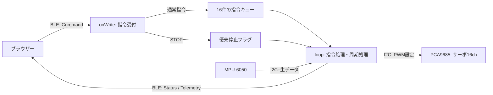

# ESP32 BLE Labの構成とmain.cpp解説

## 2026-10-26: 共有ライブラリーへのクラス化

現在は共通機能を [esp32/lib](../esp32/lib/) へ切り出し、既存のPlatformIOプロジェクトから参照する。下記の2026-10-13／14の解説は、切り出し前のコードを説明する履歴として残す。旧自由関数・グローバル変数の名前が現在の配置と同じであるとは限らない。

| 現在の配置 | 担当 |
|---|---|
| [main.cpp](../esp32-ble-lab/firmware/src/main.cpp) | 教材の初期化、16件の指令キュー、優先STOP、接続世代の検査、指令と機器クラスの対応、5秒期限監視、IMU通知周期 |
| [network.cpp](../esp32-ble-lab/firmware/src/network.cpp) | WifiNetworkの教材設定とカメラコールバックを接続 |
| [BleTransport](../esp32/lib/ble/README.md) | BLEサービス・広告・接続世代・受信、Status/Telemetry、認証済み設定JSONの分割転送 |
| [WifiNetwork](../esp32/lib/wifi/README.md) | Wi-Fi検索・接続、NVS、mDNS、HTTP/WebSocket、HMAC・制御権、BLE停止／再開の調停 |
| [Protocol](../esp32/lib/protocol/README.md) | Command検査、little endianの読み書き、Status/Telemetryの組み立て |
| [Pca9685Servos](../esp32/lib/servo/README.md) | 16CHのARM/MOVE/DISABLE、20ms間隔の補間、全停止・I²C出力異常 |
| [Mpu6050](../esp32/lib/imu/README.md) | 0x68/0x69探索・設定、生データ取得、異常後の無効化 |

各クラスは教材のconfig.hを参照せず、設定・TwoWire・コールバックを受け取る。通信のコールバックではI²Cを操作せず、制御ループで機器を更新する。出力異常の自発Statusと指令へのACK、STOPでIMU通知を維持する扱い、再接続時に自動ARMしない扱いを維持する。通信形式・UUID・NVS形式は変更しない。

カメラの基板固有処理は従来のcamera.cppに残す。通信インスタンスは基板ごとに1つをファームウェアの稼働中ずっと保持する。Wi-Fiのタスク・サーバーを破棄するAPIは今回追加しない。利用方法は [ESP32教材ガイド](../esp32/README.md)、ビルドと未確認範囲は [build-and-test.md](build-and-test.md) を参照する。

## 旧構成の記録

作成日: 2026-10-13、配置更新日: 2026-10-14（日本時間）。対象は [esp32-ble-lab/firmware/src/main.cpp](../esp32-ble-lab/firmware/src/main.cpp)。2026-10-14にrobotの作業ツリーを、`main.cpp`の未コミット変更も含めてuroaへ取り込んだ。ソースの内容は変更していない。2026-10-13の解説作成ではソース・設定・関連仕様を照合し、ビルドや実機動作の再確認は行っていない。取り込み後のビルド結果・確認範囲は [build-and-test.md](build-and-test.md) に記録する。

## 2026-10-14: Wi-Fi機能追加後の読み方

取り込み後にWi-Fi設定・NVS・mDNS・Wi-Fi制御・XIAOカメラを追加したため、現在の`main.cpp`は取り込み元と同一ではない。I²C・サーボ・IMUは共通化し、[network.cpp](../esp32-ble-lab/firmware/src/network.cpp)が設定・通信・認証、[camera.cpp](../esp32-ble-lab/firmware/src/camera.cpp)が画像を担当する。Wi-Fiも同じ`handle()`へ指令を渡し、接続世代と通知先を切り替える。起動にnetworkBegin/startBLE、サービスに設定Characteristic、loopにnetworkTickとWi-Fi通知を追加した。以下のBLE単体解説は2026-10-13時点を中心とする。現在の操作・通信・保存・制約は [Wi-Fiガイド](esp32-ble-lab-wifi.md) を参照する。今回はユーザー指定でビルドまでで、Upload・テスト・ブラウザー／実機確認は行っていない。

## 1. このプログラムの役割

`main.cpp`はESP32上で動き、BLEで受け取った指令に応じてPCA9685のサーボ用PWMを制御し、MPU-6050の加速度・角速度を通知する。ブラウザーは目標角度と移動時間を送るだけでよく、途中の角度の計算はESP32が担当する。



ここでの角度は**ESP32が出力する内部指令値**である。サーボの実角度を測る機能、姿勢角の推定、AI APIへの接続はこのファイルにない。

### 関連ファイルとライブラリー

| ファイル・ライブラリー | 役割 |
|---|---|
| [config.h](../esp32-ble-lab/firmware/include/config.h) | ピン、角度範囲、パルス幅、BLE UUID、タイムアウト |
| [platformio.ini](../esp32-ble-lab/firmware/platformio.ini) | `esp32dev`／`xiao_esp32s3`、Arduino、依存ライブラリー、BLE接続数の設定 |
| [protocol.md](../esp32-ble-lab/docs/protocol.md) | BLEパケットの仕様 |
| [diagram/ts/ble-wifi/ble.ts](../diagram/ts/ble-wifi/ble.ts) | uroa側の指令生成・IMU解析・単位変換、BLE接続、ACK待ち、定期PING |
| [web/src/protocol.ts](../../robot/esp32-ble-lab/web/src/protocol.ts)、[web/src/ble.ts](../../robot/esp32-ble-lab/web/src/ble.ts) | 取り込み元の専用Web画面。解説作成時の照合先。今回の移行対象外 |
| `Arduino.h` | `setup()`、`loop()`、`millis()`、シリアル出力など |
| `Wire.h` | I²C通信。PCA9685とIMUが同じバスを使う |
| `NimBLEDevice.h` | BLEサーバー、接続イベント、書き込み・通知 |
| `Adafruit_PWMServoDriver.h` | PCA9685へのPWM設定 |
| `<atomic>` | BLEコールバックと`loop()`が共有するフラグ・番号の読み書き |

`platformio.ini`では、Espressif32 6.10.0、NimBLE-Arduino 2.3.6、Adafruit PWM Servo Driver Library 3.0.2、Adafruit BusIO 1.17.4を指定している。`CONFIG_BT_NIMBLE_MAX_CONNECTIONS=1`でBLE接続数を1に設定する。

## 2. 設定値と内部状態

### config.hの設定

| 定数 | 値 | 意味 |
|---|---|---|
| `SDA_PIN` / `SCL_PIN` | DevKit: 21 / 22、XIAO: 5 / 6 | I²CのGPIO。XIAOの基板表記はD4 / D5 |
| `PCA_ADDRESS` | `0x40` | PCA9685のI²Cアドレス |
| `SERVO_FREQUENCY` | 50Hz | サーボPWMの周波数 |
| `MIN_ANGLE` / `MAX_ANGLE` | 6000 / 12000 | 受付範囲60～120°。角度の単位は0.01° |
| `MIN_PULSE_US` / `MAX_PULSE_US` | 1000 / 2000µs | 公称0～180°に対応させるパルス幅 |
| `HEARTBEAT_TIMEOUT_MS` | 5000ms | 指令が途切れた場合の停止判定 |
| `DEVICE_NAME` | `ESP32-BLE-Lab` | BLEのデバイス名 |

2026-10-14にXIAO ESP32S3 Sense用の`xiao_esp32s3`ビルド環境を追加した。この環境では`SDA_PIN` / `SCL_PIN`を5 / 6（基板表記D4 / D5）へ切り替える。BLEプロトコル・サーボ制御・MPU6050読み出し・停止処理はDevKitと共通。後続のWi-Fi追加以降、Senseのカメラは`camera.cpp`で別に初期化し、マイク・SDカードは使用しない。2026-10-20に設定を再確認し、起動時に実際に選択したSDA/SCL・100kHz・I²C開始結果をログへ出す処理を追加した。配線とCOM4への書き込みは [README](../esp32-ble-lab/README.md) を参照する。

例えば90°は`9000`として保持・送信する。0～180°からパルス幅への換算式を使うが、ARM/MOVEが受け付ける範囲は60～120°に制限される。

### 構造体

`Command`はBLE指令の10バイトをそのまま保持する。`Queued`はそこへ接続世代を表す`session`を付けたキュー要素である。

`Servo servos[16]`はチャンネルごとの状態を保持する。

| メンバー | 意味 |
|---|---|
| `armed` | PWM出力を有効にした状態か |
| `moving` | 時間を指定した補間中か |
| `current` | 最後に計算・設定した内部指令角度 |
| `start` / `target` | 補間の開始角度 / 目標角度 |
| `duration` | 補間時間ms |
| `started` | 補間開始時の`millis()` |

初期値は`armed=false`、`moving=false`、角度は`9000`である。角度の初期値が90°でも、起動時にサーボへ90°を指令するわけではない。

### 主な共有状態

| 変数 | 意味 |
|---|---|
| `commands` | FreeRTOSの指令キュー。最大16件 |
| `connected` | BLE接続中か |
| `mustStop` | 接続・切断・キュー飽和による全体停止要求 |
| `urgentStop` / `urgentSeq` | 優先STOP要求 / その応答に使う指令番号 |
| `session` | 接続・切断のたびに増える接続世代 |
| `pcaOK` / `imuOK` | 各デバイスを利用できると判断しているか |
| `pcaInitialized` | PCA9685の初期化に成功した履歴。エラー後の停止書き込みにも使う |
| `streamHz` | IMU通知の設定値。0、5、10、20Hz |
| `sampleSeq` | IMU通知のサンプル番号 |
| `lastCommand` | 最後にハートビート判定を更新した時刻 |
| `lastSample` / `lastMotion` | 最後のIMU読み出し / 補間更新の時刻 |

`std::atomic`を使うのは、BLE側のコールバックと`loop()`で共有する接続状態や停止要求などである。サーボ状態と通常のI²C操作は主に`loop()`側で扱う。

## 3. setup(): 起動時の初期化

Arduinoでは`setup()`が起動時に1回呼ばれ、その後`loop()`が繰り返し呼ばれる。

`setup()`の処理順は次のとおり。

1. シリアル通信を115200bpsで開始し、200ms待つ。
2. `SDA_PIN` / `SCL_PIN`でI²Cを開始する（DevKit V1はGPIO21/22、XIAO ESP32S3 SenseはGPIO5/6）。クロックは100kHz、I²Cタイムアウト設定は30ms。使用するGPIOと開始結果`OK`／`FAILED`を`I2C config:`ログに表示する。
3. I²Cアドレス1～126を探索し、応答したアドレスをシリアルへ表示する。
4. PCA9685を探索し、`pwm.begin()`で初期化する。成功時は全出力をOFFにし、50Hzを設定して再度OFFにする。
5. `setupIMU()`でMPU-6050を探索・設定する。各デバイスの結果を`OK`または`MISSING`として表示する。
6. `Queued`を16件保持する指令キューを作る。確保できなければログを出し、待機を続けてBLE初期化へ進まない。
7. BLEサーバー、サービス、3種類のCharacteristicを作り、初期Statusを設定する。
8. サービスとBLE広告を開始し、成功時にデバイス名・BLEアドレスを表示する。

PCA9685やIMUが見つからなくてもBLE初期化は続く。接続後、利用できない機器を必要とする指令にはハードウェアエラーを返す。

### BLEサービス

サービスUUIDは`f3641400-00b0-4240-ba50-05ca45bf8abc`。各Characteristicも末尾は同じで、先頭部分だけが異なる。

| Characteristic | UUID先頭 | 属性 | サイズ・用途 |
|---|---|---|---|
| Command | `f3641401` | Write | 10バイトの指令を受信 |
| Telemetry | `f3641402` | Notify | 20バイトのIMU計測値を通知 |
| Status | `f3641403` | Read / Notify | 12バイトの指令結果・状態 |

`status()`はCharacteristicの値を更新し、接続中なら通知を試みる。BLEのWrite応答は書き込みの受付を示し、指令の処理結果は別途Statusの指令番号で対応付ける。

### 広告の設定

広告とは、未接続の端末へデバイスの存在を知らせるBLEの送信である。

```cpp
adv->enableScanResponse(true);
adv->addServiceUUID(SERVICE_UUID);
adv->setName(DEVICE_NAME);
adv->start();
```

通常広告の31バイトにフラグ・128bit UUID・デバイス名を一緒に入れると容量を超えるため、名前の設定より先にスキャン応答を有効にする。このバージョンのNimBLEでは、スキャン応答が有効なら`setName()`がまずそちらへ名前を配置する。

実装はUUID追加、名前設定、広告開始の戻り値をそれぞれ確認する。失敗時は該当する`FAILED`ログを出して`setup()`から戻る。成功ログが出ることと、実端末が検出・接続できることは別の確認である。

## 4. I²CとMPU-6050の初期化

### I²C補助関数

| 関数 | 処理 |
|---|---|
| `probe(address)` | 指定アドレスへ送信を開始・終了し、応答を確認 |
| `writeRegister(reg, value)` | IMUのレジスタ番号と設定値を送信 |
| `readRegisters(reg, data, count)` | 読み出し開始レジスタを指定し、要求したバイト数を受信 |

`readRegisters()`の`Wire.endTransmission(false)`は、レジスタ指定後にSTOPを出さず、続く読み出しにつなげるための指定である。送信が失敗した場合や要求数を受信できなかった場合は`false`を返す。

### setupIMU()

専用のMPU-6050ライブラリーを使わず、`Wire`でレジスタへ直接アクセスする。

1. `0x68`を探索し、応答がなければ`0x69`を探索する。
2. `WHO_AM_I`に相当する`0x75`を読み、値が`0x68`か確認する。接続先が`0x69`でも、このコードが識別値として期待する値は`0x68`である。
3. 次の設定を順に書き込む。いずれかが失敗した時点で`false`を返す。

| レジスタ | 書き込む値 | 設定の意味 |
|---|---|---|
| `0x6B` | `0x01` | スリープ解除、PLLクロック選択 |
| `0x1A` | `0x03` | デジタルローパスフィルター。ソースコメントでは約44Hzと記載 |
| `0x19` | `9` | サンプルレート分周。ソースコメントでは内部100Hz |
| `0x1B` | `0` | ジャイロの測定範囲±250°/s |
| `0x1C` | `0` | 加速度の測定範囲±2g |

内部サンプルレートとBLE通知頻度は別である。内部100Hzの設定に対し、このプログラムが読み出して通知する頻度は最大20Hz。FIFOや割り込みを使って全内部サンプルを取り出す実装ではない。

## 5. BLEコールバックと指令キュー

### ServerCallbacks: 接続・切断

接続時は`session`を増やし、`connected=true`、`mustStop=true`にする。切断時も接続世代を増やし、`connected=false`、`mustStop=true`にする。切断後は広告の再開を試み、成功・失敗をログへ出す。

コールバックで直接サーボを操作するのではなく、次の`loop()`で出力・ストリーム・待機指令を停止する。再接続で以前の出力を自動復帰させない設計である。

キューに保存した接続世代と現在の`session`を比較することで、以前の接続から残った通常指令を実行しない。

### CommandCallbacks::onWrite(): 指令受付

受信指令は次のように振り分ける。

- 長さ10バイト、version=1、opcode=STOPなら、指令番号を`urgentSeq`へ保存し、`urgentStop=true`にする。キューへは入れない。
- それ以外は接続世代付きの`Queued`を作り、待ち時間0でキューへ入れる。
- 長さが10バイトでない場合は、ゼロ初期化した指令を入れる。`loop()`の形式検査でversion=0として拒否され、FORMAT・指令番号0となる。
- キューが満杯なら`mustStop=true`にする。

BLEの書き込みコールバックではI²C操作や指令結果の通知を行わない。通常指令の処理数を`loop()`ごとに制限し、補間・タイムアウト処理にも進めるようにしている。

優先STOPの入口が検査するのは長さ・version・opcodeだけで、通常経路のreserved検査は通らない。また、複数のSTOPが処理前に届くと`urgentSeq`は上書きされるため、STOP要求ごとに別々のACKを保持するキューではない。

## 6. Commandとhandle(): 指令の解釈

### 10バイトの指令形式

複数バイトの数値はlittle endian、つまり下位バイトが先である。`get16()`が読取り、`put16()`・`put32()`が送信データへの書込みを担当する。

| オフセット | 型 | 内容 |
|---|---|---|
| 0 | `uint8_t` | version。現在は1 |
| 1 | `uint8_t` | opcode |
| 2～3 | `uint16_t` | 指令番号`seq` |
| 4 | `uint8_t` | チャンネル。個別操作0～15、全体操作では仕様上255 |
| 5 | `uint8_t` | reserved。通常処理では0を要求 |
| 6～7 | `uint16_t` | 値`v`。角度または通知Hz |
| 8～9 | `uint16_t` | 移動時間`ms` |

`handle()`はversion、reserved、opcodeを検査し、通過したら`lastCommand`を更新する。その後、操作別に機器状態や値の範囲を検査する。このため、角度範囲エラーなどを返した指令でもハートビート時刻は更新される。

仕様では指令番号1～65535を用い、0は自発通知用とする。ブラウザーの`command()`はこの範囲を検査するが、ファームウェアの`handle()`自体には指令番号0の拒否や重複排除の処理はない。

### 操作ごとの処理

| opcode | 名前 | 処理 |
|---|---|---|
| 1 | `ARM` | 指定CHを有効化し、指定角度を即時出力。補間状態を解除 |
| 2 | `MOVE` | 有効化済みCHの目標・時間を設定。0msなら即時出力 |
| 3 | `STOP` | 全CHを無効化。通常は優先経路で処理し、待機指令も破棄 |
| 4 | `STREAM` | IMU通知を0/5/10/20Hzに設定。0で停止 |
| 5 | `PING` | Statusを返してハートビートを更新 |
| 6 | `INFO` | Statusを返す。CH指定なら角度・目標・残り時間を含む |
| 7 | `DISABLE` | 指定CHの補間・PWMを停止 |

`PING`と`INFO`は同じ処理である。`STREAM`は開始時にIMU正常を要求するが、0Hzへの停止はIMU異常でも受け付ける。

`DISABLE`はCH検査の後、サーボ状態を解除する。`pcaOK=true`の場合はOFFを書き込み、その書込みが失敗したら全CHの停止処理とIO_ERROR応答を行う。

`ARM`と`MOVE`には、CH0～15、PCA正常、角度6000～12000、移動時間10000ms以下を要求する。`ARM`も時間の上限を検査するが、動作は即時であり時間を補間に使わない。`MOVE`にはさらに`armed=true`が必要で、未有効ならNOT_ARMEDを返す。

## 7. サーボのPWMと角度補間

### output(): 角度からPWMへ

`output(ch, angle)`は、角度をパルス幅へ換算し、50Hz周期の4096分割カウントへ変換する。

```text
パルス幅µs = 1000 + (2000 - 1000) × angle / 18000
PWMカウント = round(パルス幅µs × 50 × 4096 / 1000000)
```

90°なら`angle=9000`、パルス幅1500µs、カウントは約307となる。`pwm.setPWM(ch, 0, ticks)`で周期の先頭から指定カウントまでONにする。PWM波形の生成はPCA9685が担当するため、ESP32がパルスごとにGPIOを切り替える必要はない。

### MOVEの線形補間

移動時間が0より大きい場合、`handle()`は開始角度、目標、時間、開始時刻を保存する。`loop()`は前回更新から20ms以上たつと、各CHの角度を次の式で更新する。

```text
current = start + (target - start) × elapsed / duration
```

90°から120°へ1000msで移動する指令なら、経過500msで内部指令は105°になる。実装は整数演算なので端数は整数化される。指定時間に達すると`current=target`、`moving=false`にし、最終値を出力する。

補間完了後も`armed=true`のままで、PCA9685は最後のPWMを出力し続ける。完了時のStatus通知はなく、MOVE直後のOKは**受付成功**を示す。残り時間はINFO等のStatusで取得する。

新しいMOVEを補間中に受け付けると、最後に更新した`current`を開始値として新しい補間を始める。加減速曲線、実角度のフィードバック、到達確認は行っていない。

### allOff(): 全出力の停止

全CHの`armed`と`moving`を解除し、PCAの初期化履歴があれば`pwm.setPWM(ch, 0, 4096)`を各CHへ送る。ここで4096は通常のパルス幅ではなく、全OFFの指定である。

`allOff()`自身はキューや`streamHz`を変更せず、角度・目標の値も保持する。停止理由に応じて呼び出し元がキューやストリームも停止する。

`output()`の書込みが失敗すると、`pcaOK=false`、全CH停止、指令番号0のIO_ERROR通知を行う。ARMや即時MOVEの呼び出し元は、元の指令番号でもIO_ERRORを返すことがある。通信エラー時のOFFもI²C経由の試行であり、物理的な出力停止を確認する仕組みではない。

## 8. loop(): 繰り返し処理の順序

1回の`loop()`では、次の順に処理する。

1. `mustStop.exchange(false)`で全体停止要求を取り出す。全CH停止、IMU停止、キュー破棄、時刻更新、OK・指令番号0のStatusを行う。
2. `urgentStop.exchange(false)`で優先STOPを取り出す。全CH停止、キュー破棄、時刻更新、STOPの指令番号へのOK応答を行う。IMU設定は変更しない。
3. キューから最大4件を取り出す。接続中で接続世代が一致するものだけ`handle()`で処理する。
4. 現在時刻を取り直し、ハートビートのタイムアウトを検査する。
5. 前回から20ms以上たっていればサーボ角度を補間・出力する。
6. IMU通知時刻ならセンサーを読み出して通知する。
7. `delay(2)`で2ms待ち、次の繰り返しへ進む。

`exchange(false)`はフラグの読取りと解除をまとめて行う。時間間隔は経過時間で判定しており、I²C処理やキュー処理の時間も加わるため、20msや通知Hzは厳密な周期を保証する値ではない。

### ハートビート

接続中に`now - lastCommand > 5000`となり、いずれかのCHが有効またはIMU通知中なら、全CHとIMUを停止してNOT_ARMED・指令番号0のStatusを出す。

専用Web画面の`ble.ts`は1.5秒周期でPINGを送る。PING以外の形式・opcode検査を通った通常指令も時刻を更新し、優先STOPも処理時に更新する。タイムアウト後にPINGを受けてもサーボやIMUは自動復帰せず、ARMやSTREAMを改めて送る必要がある。

このタイムアウトは`loop()`の条件分岐として実装されている。CPU停止時にも動作する独立したハードウェア監視機構ではない。

## 9. IMUの読み出しとTelemetry

`connected && imuOK && streamHz`を満たし、前回の読み出しから`1000 / streamHz`ms以上たつと計測する。10Hzなら100ms間隔である。

`readRegisters(0x3B, raw, 14)`で、加速度6バイト、温度2バイト、角速度6バイトをまとめて読む。通知では温度を省き、6軸の生値だけを送る。

センサーの16bit値は上位バイトが先であるため、通知用配列では順番を入れ替えてlittle endianにする。負の値もビット列のまま転送し、受信側が符号付き16bitとして解釈する。

| オフセット | 型 | 内容 |
|---|---|---|
| 0 | `uint8_t` | version=1 |
| 1 | `uint8_t` | 状態flags |
| 2～3 | `uint16_t` | `++sampleSeq`。桁あふれで0へ戻る |
| 4～7 | `uint32_t` | 読み出し判定時の`millis()` |
| 8～13 | `int16_t` × 3 | 加速度ax、ay、azの生値 |
| 14～19 | `int16_t` × 3 | 角速度gx、gy、gzの生値 |

`millis()`はESP32起動後の時間で、日時ではない。これも32bitの桁あふれで循環する。サンプル番号と時刻は接続・STREAM開始のたびにゼロへ初期化されない。

ファームウェア内で物理単位への変換は行わない。専用Web画面の`parseTelemetry()`が次の式を使う。

```text
加速度m/s² = raw / 16384 × 9.80665
角速度°/s = raw / 131
```

読み出しに失敗すると`imuOK=false`、`streamHz=0`にし、IO_ERROR・指令番号0を通知する。この経路ではサーボを停止しない。IMUの自動再初期化はなく、配線修復後の再初期化にはESP32の再起動が必要になる。

## 10. Statusと停止条件

### 12バイトのStatus

| オフセット | 型 | 内容 |
|---|---|---|
| 0 | `uint8_t` | version=1 |
| 1 | `uint8_t` | 結果コード |
| 2～3 | `uint16_t` | 応答する指令番号。自発通知は0 |
| 4 | `uint8_t` | 状態flags |
| 5 | `uint8_t` | CH。全体応答の既定値は255 |
| 6～7 | `uint16_t` | 内部指令角度×100 |
| 8～9 | `uint16_t` | 目標角度×100 |
| 10～11 | `uint16_t` | 補間の残り時間ms |

CHが0～15の場合だけ角度・目標・残り時間を設定する。それ以外では、この3項目はゼロのまま。停止したCHの角度・目標は最後の内部値が残るため、値があることだけではPWM有効と判断できない。

`flags()`のbit0はPCA正常、bit1はIMU正常、bit2はいずれかのCHが有効、bit3はIMU通知設定が有効である。bit2は全CHの集約値であり、Statusに指定されたCHだけの有効状態ではない。

| コード | 名前 | 意味 |
|---|---|---|
| 0 | `CODE_OK` | 受付成功・状態応答 |
| 1 | `CODE_FORMAT` | version、reserved、opcodeなどの形式エラー |
| 2 | `CODE_RANGE` | CH、角度、時間、通知Hzの範囲エラー |
| 3 | `CODE_NOT_ARMED` | 未有効CHへのMOVE、またはハートビート停止 |
| 4 | `CODE_HARDWARE` | 必要な機器を利用できない |
| 5 | `CODE_BUSY` | 定義はあるが、この実装では送信しない |
| 6 | `CODE_IO_ERROR` | I²Cの読取り・書込み失敗 |

### 停止理由ごとの違い

| 原因・操作 | PWM | IMU通知 | 待機指令 |
|---|---|---|---|
| 起動 | 全CHへOFFを設定する（PCA初期化成功時） | 初期値0で停止 | キューは空 |
| 接続・切断 | 次の`loop()`で全CH停止 | 停止 | 破棄 |
| キュー飽和 | 次の`loop()`で全CH停止 | 停止 | 破棄 |
| 優先STOP | 全CH停止 | 設定を継続 | 破棄 |
| DISABLE | 指定CH停止 | 設定を継続 | 破棄しない |
| STREAM=0 | 変更なし | 停止 | 破棄しない |
| ハートビート期限超過 | 全CH停止 | 停止 | この分岐では破棄しない |
| PCA出力のI²Cエラー | 全CHのOFFを試行 | 設定を継続 | この経路では破棄しない |
| IMU読み出しエラー | 変更なし | 停止 | 破棄しない |

キュー飽和では、失われた指令の番号に対するBUSYやACKを返す実装はない。全体停止時にOK・指令番号0を通知するため、これを個別指令の成功応答と解釈しない。専用Web画面は個別ACKを最大2.5秒待ち、期限超過なら切断する。

`pcaOK`・`imuOK`はソフトウェアが把握した状態であり、機器を常時診断した結果ではない。エラー後のPCA再初期化も実装していない。PWM停止はサーボ電源の遮断ではなく、I²C故障時の停止を保証する仕組みでもない。

## 11. 指令を送ったときの具体例

CH0を90°で有効化し、1秒かけて105°へ動かす場合を考える。

1. BLE接続時の全体停止処理が終わった後、`ARM(seq=1, ch=0, value=9000, duration=0)`を送る。
2. `handle()`がCH0を有効化し、90°相当のPWMを出力する。StatusはOK、指令番号1、内部角度・目標とも9000となる。
3. `MOVE(seq=2, ch=0, value=10500, duration=1000)`を送る。
4. `handle()`が補間条件を保存し、指令番号2へOKを返す。この時点で移動は完了していない。
5. `loop()`が約20msごとに内部指令を更新する。500ms経過時の計算値は9750、つまり97.5°となる。
6. 1000msに達すると目標10500へ設定し、補間を終了する。PWMは出力を継続する。
7. `STOP`を送ると優先フラグ経由で全CHと待機指令を停止する。IMU通知を開始済みなら、その通知は続く。

MOVEの10バイトは次のようになる。

```text
01 02 02 00 00 00 04 29 E8 03
│  │  └─seq=2     └─10500 └─1000ms
│  └─MOVE
└─version=1
```

チャンネルはオフセット4の`00`、reservedはオフセット5の`00`。little endianなので、10500=`0x2904`は`04 29`、1000=`0x03E8`は`E8 03`になる。

## 12. ソースを読む順序と確認範囲

初めて読む場合は、`config.h` → `Servo`などの構造体 → `setup()` → BLEコールバック → `handle()` → `loop()` → `status()`・IMU通知の順で追うと、設定、指令受付、実行、応答の関係を理解しやすい。

この文書で確認したのは、現在のソースにある処理、設定値、専用Web画面のプロトコルとの対応である。実サーボの到達角度、停止までの実時間、BLE通知の到達、実端末の接続は今回検証していない。

配線・電源は [wiring.md](../esp32-ble-lab/docs/wiring.md)、ビルド・書き込み・uroaでの操作手順は [README.md](../esp32-ble-lab/README.md)、取り込み元の過去の検証記録は [validation.md](../esp32-ble-lab/docs/validation.md)を参照する。uroaとの全体的な関係は [architecture.md](architecture.md)を参照する。
